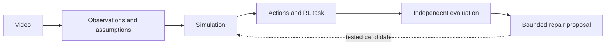

# Project overview

Weft is a local development environment for building and testing simulations from
video evidence. It connects observation, reconstruction, interactive control and
evaluation while retaining the assumptions behind each result.

[Quick start](README.md#get-started) · [Sandbox setup](sandbox/README.md) ·
[Avatar Studio](tools/avatar-assets/README.md)

## How it works



1. **Observe.** Decode the video and retain pose/object estimates, timestamps,
   confidence, missing observations and competing interpretations.
2. **Construct.** Build a supported world with explicit camera, geometry, contact
   and control assumptions. Unsupported inputs retain an inspectable failure.
3. **Interact.** Apply actions, reset state, select compatible avatars and record
   sessions. Learned control is available for supported task profiles.
4. **Evaluate.** Compare predictions and outcomes using fixed criteria. Meta
   models can contribute tracking, evidence review and bounded test selection;
   proposals do not automatically become accepted repairs.

Reinforcement learning (RL) means learning actions from feedback. Recorded pose
playback and programmed reference controllers are different modes, not learned policies.

## Capabilities and limitations

| Area | Available | Not yet established |
| --- | --- | --- |
| Video intake | Uploads, processing stages, evidence inspection and failure reports | Reliable reconstruction across arbitrary videos |
| Simulation | Rolling, planar, rigid-object and articulated-body profiles; shared MuJoCo worlds | Accurate recovery of hidden depth, materials, grasp/contact and balance |
| Interaction | Manual controls, explicit tasks, reset, recording and action replay | Physical accuracy of changed-action predictions |
| Learning | Bounded training, baselines and evaluation on supported profiles | Consistent improvement over simple controllers |
| Meta integration | SAM tracking, Muse review and constrained controller-choice tests | General autonomous physical repair |
| Avatars | Built-in appearances, compatible-rig imports and state-driven motion | Automatic compatibility for arbitrary models; reliable Studio skin deformation |

Intake supports videos up to **60 seconds, 1,800 frames and 100 MB**, with further
checks for each reconstruction path. Keep observed, inferred, assumed and unknown
properties distinct. Illustrative muscles and assisted body controls are not
measured muscle activity, recovered anatomy or validated biomechanics.

## Evaluation snapshot

Development observations from November 3, 2026; these are small, scoped studies,
not an external benchmark or a guarantee for new inputs.

- Camera framing kept all 235 saved states visible for two built-in avatars;
  underlying body-position tracking still failed its task criteria.
- A real Muse-selected controller candidate was tested and rejected under the
  unchanged scoring rules. No accepted physical repair was demonstrated.
- Three unfamiliar exercise videos were rejected during reconstruction;
  **0/3 reached a playable environment**, so task success was not evaluated.
- In a separate ball task, a learned policy passed 8/12 changed starts while
  a fixed feedback controller passed 12/12. This did not show a learning advantage.

Exact replay verifies software consistency. It does not, by itself, validate the
reconstructed physics. Evaluation inputs must remain separate from tuning data.

## Architecture

| Location | Responsibility |
| --- | --- |
| `src/weft/` | Evidence processing, reconstruction, simulation and task evaluation |
| `src/weft/assets/` | Portal, lab viewer and avatar rendering |
| `scripts/` / `tests/` | Reproducible studies and contract checks |
| `website/` / `sandbox/` | Independent landing-page and sandbox entry points |
| `tools/avatar-assets/` | Separate character-authoring environment |
| `hosting/` | Hosting implementation and deployment configuration |

The landing page uses Node.js; the sandbox uses an isolated Python dependency
environment. This is process/dependency separation, not a container security
boundary. API keys stay server-side, and paid operations use persistent spending
ledgers. See [API configuration](sandbox/README.md#api-configuration).

## Roadmap

- Improve identity tracking and reconstruction across unfamiliar supported inputs.
- Constrain camera, scale, geometry and equipment contact using stronger evidence.
- Repair avatar rig/skin compatibility and validate representative motion.
- Demonstrate useful learning and supported repairs against fixed independent baselines.
- Improve end-to-end usability, reproducibility and resource measurements.

## Development

Run checks that cover the component being changed:

```sh
npm run test:local
node sandbox/run.mjs --check
.venv-lab/bin/python -m pytest tests/<affected_test>.py
```

Keep recorded runs immutable, retain failed attempts, and use new output directories
for new experiments. Local project data is Git-ignored: back up needed recordings,
credentials and spending history separately. Dataset and asset attribution remain
with their source records.
