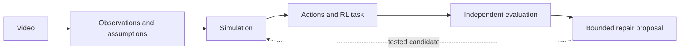

# Project overview

Weft is a local development environment for building and testing simulations from
video evidence. It connects observation, reconstruction, interactive control and
evaluation while retaining the assumptions behind each result.

[Quick start](README.md#get-started) · [Sandbox setup](sandbox/README.md) ·
[Avatar Studio](tools/avatar-assets/README.md)

## How it works



1. **Observe.** Decode the video and retain pose/object estimates, timestamps,
   confidence, missing observations and competing interpretations.
2. **Construct.** Build a supported world with explicit camera, geometry, contact
   and control assumptions. Unsupported inputs retain an inspectable failure.
3. **Interact.** Apply actions, reset state, select compatible avatars and record
   sessions. Learned control is available for supported task profiles.
4. **Evaluate.** Compare predictions and outcomes using fixed criteria. Meta
   models can contribute tracking, evidence review and bounded test selection;
   proposals do not automatically become accepted repairs.

Reinforcement learning (RL) means learning actions from feedback. Recorded pose
playback and programmed reference controllers are different modes, not learned policies.

## Capabilities and limitations

| Area | Available | Not yet established |
| --- | --- | --- |
| Video intake | Any decodable video takes a principled route: over-length clips get an explicit bounded window, person scenes go to the exercise flow and its prompts, object scenes try color regions then AI/motion appearance intervals on a shrinking ladder, and a refused exercise clip computes its own supported window (same frozen constraints) for a one-click windowed retry; every attempt is preserved | Fast small objects and moving-camera footage can exhaust the tracker ladder; multi-person admission needs the explicit person-region flow |
| Simulation | Rolling, planar, rigid-object and articulated-body profiles; shared MuJoCo worlds | Accurate recovery of hidden depth, materials, grasp/contact and unassisted balance |
| Interaction | Manual controls, explicit tasks, reset, recording and action replay; disclosed root assistance | Physical accuracy of changed-action predictions |
| Learning | Bounded training, baselines and evaluation on supported profiles | Consistent improvement over simple controllers |
| Meta integration | SAM tracking, Muse review and constrained controller-choice tests | General autonomous physical repair |
| Avatars | Built-in appearances plus a one-click pre-generated library; prompt-to-avatar creation in the portal through the managed local Avatar Studio with recorded per-job spending grants; finished models auto-pack (derived roles, scale, orientation) and land in the chooser; a created character is live-verified inside a recorded, gate-passing session | Fresh single-shot generations currently stop at the author's coat-coverage gates (preview-preset mesh density is below its thresholds); rigs without elbow/knee joints are refused by design |

Intake supports videos up to **60 seconds, 1,800 frames and 100 MB**, with further
checks for each reconstruction path. Keep observed, inferred, assumed and unknown
properties distinct. Illustrative muscles and assisted body controls are not
measured muscle activity, recovered anatomy or validated biomechanics.

## Evaluation snapshot

Development observations from November 3, 2026; these are small, scoped studies,
not an external benchmark or a guarantee for new inputs.

- Rerunning the frozen three-video evaluation after the transient-hypothesis screen:
  **2/3 unfamiliar videos complete the full pipeline** (admission, body, world,
  lab and a 450+ step playable rollout). The multi-person clip stays refused with
  recorded reasons. Evidence: `.local/hackathon-unseen-20261103-06/`.
- With disclosed three-axis root assistance (the default on both portal routes),
  **both admitted unfamiliar videos and the recorded demo world pass every frozen
  task gate** (for example overhead-squat: angular 0.068 vs 0.35, root 0.009 vs
  0.15). Unassisted tracking still fails and remains the honest hard mode.
  Evidence: `.local/tracking-study-01/`.
- Landmark depth flips used to park limb references on the dual Euler branch for
  seconds (a 1.1-rad peak tracking spike). References are now screened in rotation
  space and re-charted with clean priors; bridged samples are explicit
  zero-confidence proposals and the represented rotations never change.
- A complete live-portal journey on the previously rejected sots-press clip —
  upload, admission, saved-body world, built-in and imported avatars, one
  continuous 456-step recording with a mid-take avatar swap, task success true,
  video/replay export — runs in about 14 seconds.
  Evidence: `.local/portal-unfamiliar-source-acceptance-02/continue-result-02.json`.
- Generalized-route diversity over six real clips (long billiards, hands with pucks,
  hand-cranked toy van, handheld elastic pendulum, broadcast carom, multi-person
  dance): the pendulum runs the **complete generalized chain live** — appearance
  interval, 3D spatial hypothesis, trained policy, interactive lab, recorded and
  exported session in 11 seconds; both person/mixed scenes reach the exercise flow's
  interactive inventory prompt; the three fast-ball clips exhaust the tracking ladder
  with every attempt preserved. Evidence: `.local/portal-generalized-05/result.json`.
- A real Muse-selected controller candidate was tested and rejected under the
  unchanged scoring rules. No accepted physical repair was demonstrated.
- The portal now offers a pre-generated character library (one-click import, no AI
  calls) and text-to-avatar creation: a prompt starts a managed local Avatar Studio
  job, the user's verbatim approval is recorded as the targeted OpenAI/Meshy grants,
  progress streams into the portal as live stage cards, and the finished model
  auto-packs into the chooser. After the administrator raised the avatar agent
  ceiling to $50 (recorded as an append-only, approval-bound ledger raise), the
  full paid chain ran live three times: recorded grants, a validated AI plan, real
  mesh generation, and the author's own quality review — which refused all three
  single-shot deliveries honestly (one geometry mismatched the planned creature;
  two failed coat-coverage thresholds at preview-preset mesh density), each with
  complete receipts. Two stranded planning leases from those runs were released
  through new sealed custody ceremonies that prove process exit and provider-folder
  absence without touching charges. Evidence: `.local/avatar-create-01/` through
  `-06/`, `.local/studio-release-01/`, `-02/`, `.local/avatar-adopt-01/`.
- A fresh never-processed clip (Wikimedia Commons waiters squat, CC BY-SA 4.0) was
  verified end to end: its windowed upload admits locally with zero API calls, builds
  the saved-body world, and completes a recorded 246-control session with task
  success true and zero failed gates (angular 0.046 vs 0.35, peak 0.110 vs 0.70).
  Evidence: `.local/verify-video-01/`.
- The manual trim-hunting that run needed is now the pipeline's own job: a refused
  exercise preflight records a supported-window proposal computed from its saved
  evidence under the unchanged constraints (recorded competing-review verdicts, the
  0.25 s root-reference horizon, the 0.8 coverage floor, a 2 s defect-free settling
  prefix) plus the encoded windowed derivative, and one explicit request runs an
  ordinary child preflight on it. Live: the clip refused over two detector flickers
  proposed 3.8-19.3 s itself; the child admitted on the first attempt with the
  original refusal preserved and zero API calls. Evidence: `.local/verify-video-02/`.
- The capstone demo journey is live-verified end to end in 14.1 seconds: the
  sots-press world, 456 continuous reference controls in one recording, a mid-take
  appearance swap from the robot to a character created through the text flow
  ("Created: Studio panda"), task success true with zero failed gates (angular
  0.106 vs 0.35, root 0.018 vs 0.15), and exported video, replay and event logs.
  Evidence: `.local/demo-capstone-01/continue-result.json`.
- Generated avatars no longer need hand-written delivery configuration. An automatic
  resolver maps a rig's bones to Weft's ten body roles by name synonyms checked against
  skeleton structure, and derives scale and orientation from the rig's own measured
  up direction. It reproduces the hand-authored panda mapping exactly and its
  orientation within 4 degrees, resolves 10 of 12 saved Studio rigs across four naming
  conventions (including Mixamo, where it correctly prefers the humerus over the
  clavicle), and refuses the 2 that genuinely lack elbow or knee joints. A native
  generated model was delivered and imported with no authored config.
  Evidence: `.local/avatar-autopack-02/`.
- Three bounded Studio-panda weight-space repairs failed, but a Blender bone-heat
  re-skin through a watertight proxy (`tools/avatar-assets/scripts/blender_reskin_proxy.py`)
  produced a clean labeled derivative: mapped-role severe stretch 752→80, recorded-pose
  severe edges ~309→~107 per frame, visually coherent. It ships as the separate asset
  `studio-panda-470-weft-reskin`; the robot stays the default.
  Evidence: `.local/studio-skin-repair-01/NOTES.md`.
- In a separate ball task, a learned policy passed 8/12 changed starts while
  a fixed feedback controller passed 12/12. This did not show a learning advantage.

Exact replay verifies software consistency. It does not, by itself, validate the
reconstructed physics. Evaluation inputs must remain separate from tuning data.

## Architecture

| Location | Responsibility |
| --- | --- |
| `src/weft/` | Evidence processing, reconstruction, simulation and task evaluation |
| `src/weft/assets/` | Portal, lab viewer and avatar rendering |
| `scripts/` / `tests/` | Reproducible studies and contract checks |
| `website/` / `sandbox/` | Independent landing-page and sandbox entry points |
| `tools/avatar-assets/` | Separate character-authoring environment |
| `hosting/` | Hosting implementation and deployment configuration |

The landing page uses Node.js; the sandbox uses an isolated Python dependency
environment. This is process/dependency separation, not a container security
boundary. API keys stay server-side, and paid operations use persistent spending
ledgers. See [API configuration](sandbox/README.md#api-configuration).

## Roadmap

- Extend admission beyond single-person clips and qualify unassisted tracking.
- Constrain camera, scale, geometry and equipment contact using stronger evidence.
- Qualify the re-skinned Studio derivative across more poses and extend the proxy
  re-skin to arbitrary imported models.
- Demonstrate useful learning and supported repairs against fixed independent baselines.
- Improve end-to-end usability, reproducibility and resource measurements.

## Development

Run checks that cover the component being changed:

```sh
npm run test:local
node sandbox/run.mjs --check
.venv-lab/bin/python -m pytest tests/<affected_test>.py
```

Keep recorded runs immutable, retain failed attempts, and use new output directories
for new experiments. Local project data is Git-ignored: back up needed recordings,
credentials and spending history separately. Dataset and asset attribution remain
with their source records.
