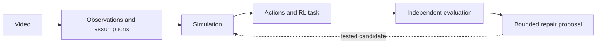

# Project overview

Weft is a local development environment for building and testing simulations from
video evidence. It connects observation, reconstruction, interactive control and
evaluation while retaining the assumptions behind each result.

[Quick start](README.md#get-started) · [Sandbox setup](sandbox/README.md) ·
[Avatar Studio](tools/avatar-assets/README.md)

## How it works



1. **Observe.** Decode the video and retain pose/object estimates, timestamps,
   confidence, missing observations and competing interpretations.
2. **Construct.** Build a supported world with explicit camera, geometry, contact
   and control assumptions. Unsupported inputs retain an inspectable failure.
3. **Interact.** Apply actions, reset state, select compatible avatars and record
   sessions. Learned control is available for supported task profiles.
4. **Evaluate.** Compare predictions and outcomes using fixed criteria. Meta
   models can contribute tracking, evidence review and bounded test selection;
   proposals do not automatically become accepted repairs.

Reinforcement learning (RL) means learning actions from feedback. Recorded pose
playback and programmed reference controllers are different modes, not learned policies.

## Capabilities and limitations

The local demo opens each studio on its inspectable model and final recording.
Compact playback, camera and zoom controls keep the result central. A numbered
walkthrough then connects the original footage to saved reconstruction assets,
source receipts and available task outcomes; evidence can be previewed or downloaded.
Kinematic pose replay, recorded simulation and authenticated live control remain
distinct. Playback is user-started and pauses offscreen or when the page is hidden.
Public exhibits use only explicitly exported evidence; private stage bundles and
recorded models retain authentication.
The landing server keeps `/demo`,
its assets, lab views and authenticated API calls on port 3000, forwarding only
sandbox routes to its loopback backend with Host/Origin checks and token
authentication intact.
The landing page links to the walkthrough through matching icon buttons that
reveal "Build your world" on hover or keyboard focus.
Clicking the Weft wordmark opens minimal contents links to all five main sections
in reading order, with native navigation and keyboard-accessible dismissal.
The headline reveals with temporary word-specific icons and short explanations
on hover, keyboard focus or tap.
The demo header’s Build control transforms into an inline code field and unlock action;
once authenticated, it leads directly to the builder.
Its example viewer defaults to video comparison, with compact version and
interaction icon toggles; only comparison shows the timeline.
The landing page also explains the research goals, model roles and intended
benefit through a conceptual observation-to-experiments illustration.
Active runs have a local tenth-second elapsed clock between status polls; saved
results open directly without replaying processing steps or progress.
The demo opens on curated finished recordings without requiring access. Only
explicit showcase examples are public; visitor runs and live controls stay private.
The wordmark returns home. Finished examples are browsed inline on `/demo` with
swipe, arrow and keyboard navigation. Open studio navigates to
`/demo/studio/STUDIO_ID`, a reloadable page for that specific result with a link
back to the examples. Public examples stay public; saved private runs require access.
Only the explicitly curated source clips are public, with attribution retained.
The ten curated comparisons cover a rolling ball and nine human movements, including
presses, squats, a deadlift, jumping jacks and a lunge. Each pairs the original footage
with one focused result. Human previews show saved reconstructed motion on a neutral
articulated body, not learned full-body control or validated biomechanics. Equipment
and contact forces are not reconstructed. Saved personal runs follow these examples.
Export receipts preserve source hashes, matching time windows and presentation changes;
the rolling model retains its documented quarter-speed playback.
The gallery distinguishes loading, empty and
unavailable states, with bounded requests and a retry that never starts a run.
`npm run demo` manages both local processes in one terminal and stops both on
Ctrl+C without deleting saved runs or changing spending allowances.
Startup checks both ports and existing collection ownership before launching;
conflicts leave the running services and saved state untouched.
Cancelled media downloads stop at the disconnected socket without retrying an
error response; subsequent video range requests remain available.
The walkthrough accepts a demo code to establish its local API session; an
optional `access_code` URL parameter only prefills the field. Ctrl+C waits for
sandbox cleanup without a timed hard kill, including after repeated presses.

| Area | Available | Not yet established |
| --- | --- | --- |
| Video intake | Any decodable video takes a principled route: over-length clips get an explicit bounded window, person scenes go to the exercise flow and its prompts, object scenes try color regions then AI/motion appearance intervals on a shrinking ladder, and a refused exercise clip computes its own supported window (same frozen constraints) for a one-click windowed retry; every attempt is preserved | Fast small objects and moving-camera footage can exhaust the tracker ladder; multi-person admission needs the explicit person-region flow |
| Simulation | Rolling, planar, rigid-object and articulated-body profiles; shared MuJoCo worlds | Accurate recovery of hidden depth, materials, grasp/contact and unassisted balance |
| Interaction | Manual controls, explicit tasks, reset, recording and action replay; disclosed root assistance | Physical accuracy of changed-action predictions |
| Learning | Bounded training, baselines and evaluation on supported profiles | Consistent improvement over simple controllers |
| Meta integration | SAM tracking, Muse review and constrained controller-choice tests | General autonomous physical repair |
| Avatars | Built-in appearances plus a one-click pre-generated library; prompt-to-avatar creation in the portal through the managed local Avatar Studio with recorded per-job spending grants; finished models auto-pack (derived roles, scale, orientation) into welded smooth-shaded deliveries budgeted in vertex currency (~14k triangles for the panda vs ~6k shattered ones before) and land in the chooser; a created character is live-verified inside a recorded, gate-passing session | Fresh single-shot generations currently stop at the author's coat-coverage gates (preview-preset mesh density is below its thresholds); rigs without elbow/knee joints are refused by design; earlier library zips predate the welded delivery and look faceted until re-packed |

Intake supports videos up to **60 seconds, 1,800 frames and 100 MB**, with further
checks for each reconstruction path. Keep observed, inferred, assumed and unknown
properties distinct. Illustrative muscles and assisted body controls are not
measured muscle activity, recovered anatomy or validated biomechanics.

## Evaluation snapshot

Development observations from November 3, 2026; these are small, scoped studies,
not an external benchmark or a guarantee for new inputs.

- Rerunning the frozen three-video evaluation after the transient-hypothesis screen:
  **2/3 unfamiliar videos complete the full pipeline** (admission, body, world,
  lab and a 450+ step playable rollout). The multi-person clip stays refused with
  recorded reasons. Evidence: `.local/hackathon-unseen-20261103-06/`.
- With disclosed three-axis root assistance (the default on both portal routes),
  **both admitted unfamiliar videos and the recorded demo world pass every frozen
  task gate** (for example overhead-squat: angular 0.068 vs 0.35, root 0.009 vs
  0.15). Unassisted tracking still fails and remains the honest hard mode.
  Evidence: `.local/tracking-study-01/`.
- Landmark depth flips used to park limb references on the dual Euler branch for
  seconds (a 1.1-rad peak tracking spike). References are now screened in rotation
  space and re-charted with clean priors; bridged samples are explicit
  zero-confidence proposals and the represented rotations never change.
- A complete live-portal journey on the previously rejected sots-press clip —
  upload, admission, saved-body world, built-in and imported avatars, one
  continuous 456-step recording with a mid-take avatar swap, task success true,
  video/replay export — runs in about 14 seconds.
  Evidence: `.local/portal-unfamiliar-source-acceptance-02/continue-result-02.json`.
- Generalized-route diversity over six real clips (long billiards, hands with pucks,
  hand-cranked toy van, handheld elastic pendulum, broadcast carom, multi-person
  dance): the pendulum runs the **complete generalized chain live** — appearance
  interval, 3D spatial hypothesis, trained policy, interactive lab, recorded and
  exported session in 11 seconds; both person/mixed scenes reach the exercise flow's
  interactive inventory prompt; the three fast-ball clips exhaust the tracking ladder
  with every attempt preserved. Evidence: `.local/portal-generalized-05/result.json`.
- A real Muse-selected controller candidate was tested and rejected under the
  unchanged scoring rules. No accepted physical repair was demonstrated.
- The portal now offers a pre-generated character library (one-click import, no AI
  calls) and text-to-avatar creation: a prompt starts a managed local Avatar Studio
  job, the user's verbatim approval is recorded as the targeted OpenAI/Meshy grants,
  progress streams into the portal as live stage cards, and the finished model
  auto-packs into the chooser. After the administrator raised the avatar agent
  ceiling to $50 (recorded as an append-only, approval-bound ledger raise), the
  full paid chain ran live three times: recorded grants, a validated AI plan, real
  mesh generation, and the author's own quality review — which refused all three
  single-shot deliveries honestly (one geometry mismatched the planned creature;
  two failed coat-coverage thresholds at preview-preset mesh density), each with
  complete receipts. Two stranded planning leases from those runs were released
  through new sealed custody ceremonies that prove process exit and provider-folder
  absence without touching charges. Evidence: `.local/avatar-create-01/` through
  `-06/`, `.local/studio-release-01/`, `-02/`, `.local/avatar-adopt-01/`.
- A fresh never-processed clip (Wikimedia Commons waiters squat, CC BY-SA 4.0) was
  verified end to end: its windowed upload admits locally with zero API calls, builds
  the saved-body world, and completes a recorded 246-control session with task
  success true and zero failed gates (angular 0.046 vs 0.35, peak 0.110 vs 0.70).
  Evidence: `.local/verify-video-01/`.
- The manual trim-hunting that run needed is now the pipeline's own job: a refused
  exercise preflight records a supported-window proposal computed from its saved
  evidence under the unchanged constraints (recorded competing-review verdicts, the
  0.25 s root-reference horizon, the 0.8 coverage floor, a 2 s defect-free settling
  prefix) plus the encoded windowed derivative, and one explicit request runs an
  ordinary child preflight on it. Live: the clip refused over two detector flickers
  proposed 3.8-19.3 s itself; the child admitted on the first attempt with the
  original refusal preserved and zero API calls. Evidence: `.local/verify-video-02/`.
- The capstone demo journey is live-verified end to end in 14.9 seconds: the
  sots-press world, 456 continuous reference controls in one recording, a mid-take
  appearance swap from the robot to the text-created character's high-fidelity
  delivery, task success true with zero failed gates (angular 0.106 vs 0.35, root
  0.018 vs 0.15), and exported video, replay and event logs. The delivery packer
  used to explode every triangle corner into private vertices, which forced ~6k
  flat-shaded cracked triangles under the consumer's vertex bound; deliveries now
  keep welded source topology, restore smooth shading, and budget vertices
  directly, so the same panda ships 14,255 clean triangles within unchanged
  consumer caps. The authored skin weights then needed hygiene, not re-skinning:
  bone-heat re-skins score few severe-stretch edges yet collapse in rendered
  motion (regions follow wrong bones once only the ten mapped roles are driven),
  while pruning anatomically distant influences from the authored weights removes
  the sweeping blade artifacts with face, body and shoulder dragon intact. The
  demo asset is "Created: Studio panda (clean)"; remaining stretch is the plush
  shoulder band lengthening to the body's proportions, a stylized retarget
  property, not a defect. Evidence: `.local/demo-capstone-02/`,
  `.local/avatar-quality-01/` through `-05-pack/`.
- A guided reviewer walkthrough runs the whole product from one page at `/demo`: an
  access gate, a clip source, seven live steps and a carousel of finished runs, with
  finished runs also browsable at `/demo/runs`. Each step states what it does, what it
  is worth, and leaves a downloadable bundle of its own evidence (43 KB to 8.4 MB).
  Nothing in the page reimplements the pipeline — a worker thread drives the portal's
  own HTTP API exactly as a person would, so a refused clip stays refused with its
  reason instead of falling back to a sample. Live-verified end to end at 43-78
  seconds for all seven steps, task success true with zero failed gates, and a real
  Meta Muse review returning three hypotheses with its recorded cost. Because judge
  footage is admitted in only 3 of 8 real exercise clips — one person, plain
  background, fixed camera, one continuous shot is a narrow envelope — the three
  clips whose whole chain was measured are offered as one-click sources, each
  labelled with its end-to-end time and its learned-versus-random contrast.
- Generated avatars no longer need hand-written delivery configuration. An automatic
  resolver maps a rig's bones to Weft's ten body roles by name synonyms checked against
  skeleton structure, and derives scale and orientation from the rig's own measured
  up direction. It reproduces the hand-authored panda mapping exactly and its
  orientation within 4 degrees, resolves 10 of 12 saved Studio rigs across four naming
  conventions (including Mixamo, where it correctly prefers the humerus over the
  clavicle), and refuses the 2 that genuinely lack elbow or knee joints. A native
  generated model was delivered and imported with no authored config.
  Evidence: `.local/avatar-autopack-02/`.
- Three bounded Studio-panda weight-space repairs failed, but a Blender bone-heat
  re-skin through a watertight proxy (`tools/avatar-assets/scripts/blender_reskin_proxy.py`)
  produced a clean labeled derivative: mapped-role severe stretch 752→80, recorded-pose
  severe edges ~309→~107 per frame, visually coherent. It ships as the separate asset
  `studio-panda-470-weft-reskin`; the robot stays the default.
  Evidence: `.local/studio-skin-repair-01/NOTES.md`.
- In a separate ball task, a learned policy passed 8/12 changed starts while
  a fixed feedback controller passed 12/12. This did not show a learning advantage.
- The hosted container now runs the exercise pipeline, not only the rolling-ball one.
  One image serves both; a request header selects which, and the exercise lane gets a
  larger upload bound and a longer deadline. A submission returns the 21 artifacts a
  browser needs — pose evidence, the articulated body and authored ground, the
  executable task, the trained policy with its rollout, and both evaluations — plus a
  flat summary carrying the real policy-versus-baseline numbers. Measured in-container
  on 2 vCPU: 12-43 s end to end across eight clips, environment archives 5.6-12.2 MB.
  The summary previously shipped empty baselines because it read the reference-servo
  artifact instead of the reinforcement-learning one; those are different measurements
  and are now distinguished and tested. Evidence: `.local/hosted-sweep-2/`,
  `.local/hosted-windows-1/`.
- The hosted exercise lane also returns an avatar-ready world, which it previously could
  not. Its reinforcement-learning scene is profile `exercise-v3`, and the client-side
  retargeter refuses that profile, so a visitor could generate an environment and then had
  nothing to replace the character in. The lane now runs a second stage that rebuilds the
  same body as a `shared-world-v3` scene, and the hosted service serves the predefined
  avatars over the lab's own `/api/avatar/<key>/render.json` contract, pre-imported at build
  time and keyed by content digest. Verified by substituting both hosted avatars onto a
  hosted archive with the browser's own retargeting module: 8,338 and 11,036 vertices per
  frame, every vertex finite, and the avatar's own bone lengths preserved to 1e-15 — the
  measurement that distinguishes retargeting from stretching a rig to fit. Appearance is
  appearance: a substituted avatar never drives physics. Evidence: `.local/hosted-check-6/`,
  `.local/hosted-e2e-1/`.
- Avatar substitution is verified for **seven appearances on the deployed environment**:
  the two predefined deliveries the hosted service serves, and five AI-generated packs from
  the Avatar Studio (Meshy geometry with an authored or auto-resolved rig). 8,338 to 19,114
  vertices per frame, every vertex finite, worst bone-length drift 1.4e-15. The generated
  packs are deliberately **not** shipped by the hosted build: they are untracked local
  evidence, and a build that depended on them would silently produce a different catalog
  from a clean clone. Generation itself remains a separate Studio service, not a hosted
  endpoint. Evidence: `.local/generated-avatars/`, `.local/hosted-live-4/`.
- The two stages now run concurrently, which is where the real latency was. They share only
  the source video, so sequencing them paid the sum of two independent costs; the lab is
  already its own process and the appearance stage is dominated by pose and MuJoCo inside
  released-GIL native code, so a thread genuinely overlaps. **Production: 147 s to 110.7 s on
  the same clip with byte-identical results.** In-container 31-32 s to 22.9 s, arm64 and not a
  hosted figure. An earlier note
  here concluded no structural win remained; that was wrong, and it was wrong because it
  reasoned about the stages' cost without asking whether they had to be ordered at all.
- End-to-end latency on deployed hardware is **68.9 s** client-side on the reference clip
  (job 62.8 s), from 147 s when this work started: inside the 5-minute preferred bound, above
  the 1-minute optimum. Deployed spread across the pack: waiters-squat 66-69 s,
  bodyweight-squats 108.4 s, jumping-jacks 184.6 s, all complete with an avatar-ready scene
  and 100/100 learned. The job's own timers are now read off production rather than a laptop,
  and they overturn the explanation committed here before them. waiters-squat, deployed, with
  **zero retries**: 6.1 s outside the job, and **62.12 s of the 62.8 s job is one lab worker
  run** (`normalize` 0.02 s, `prepare_lab` 0.0 s, `archive` 0.67 s, `appearance_join` 0.0 s).
  The retry ladder explains none of this clip, because this clip retries nothing.
  Evidence: `.local/deployed-timers-ws2/hosted-e2e.json`.
- **The ladder decomposition published here was measured on the wrong machine.** Local
  containers are arm64 on an M-series Mac; Cloudflare Containers are amd64. The identical clip
  is 16.4 s in the local container against 62.1 s deployed -- **3.8x** -- so every
  "in-container" figure, the 41.21 s jumping-jacks ladder breakdown included, describes a
  laptop and must not be quoted as hosted. That is the common root of seven successive wrong
  explanations of deployed latency here: reference duration, training cost, normalization, the
  appearance stage, pose frame count, clip length, and the retry ladder. Each was arithmetic
  over numbers from a different machine than the one being explained. The retry ladder is real
  and does cost what was recorded -- on arm64, for clips that retry; it is not why the
  simplest clip takes 62 s on Cloudflare.
- What production actually spends on waiters-squat: training 600 episodes **10.35 s**,
  evaluating three policies over 100 episodes each **~16 s**, pose and body fit **~4 s**,
  a 38 s archive-visible span, and ~24 s inside the worker before its first artifact. The
  scored deliverable -- the 100/100 against 1/100 against 0/100 comparison the product leads
  with -- is roughly 26 s of the 62 s. The quality trade recorded against bounding the
  reference stays rejected, and was mis-attributed the same way.
  Three changes got there, each measured rather than reasoned: 600 training episodes instead
  of 1,500 (identical scored numbers), the two stages overlapped so the appearance stage adds
  nothing to the visitor's sequence, and four vCPU so the overlap does not push the lab past
  its internal learning budget. An earlier note concluding that the optimum was unreachable was wrong twice over --
  it rested on an overhead decomposition that turned out to be 6 s rather than 38 s, and on
  reverting the overlap without ever giving it cores.
- An earlier decomposition here claimed roughly 24 s of container cold start and 16 s of
  transport. **Both were wrong.** Measured against the job's own clock on two consecutive
  deployed submissions: client 115.1 s against job 107.6 s cold, and client 113.3 s against
  job 108.6 s warm -- so only **6 to 7 s** sits outside the job at all, not 38 s. The earlier
  figure came from differencing the lab's report against artifact timestamps whose zip
  granularity and baseline I had not validated, and then attributing the residue to
  provisioning. Importing the whole ML stack really does cost 0.52 s, but that refuted a claim
  I should not have made rather than confirming one. The robust numbers are the ones taken as
  deltas within one archive: on that longer clip, training 34 s and evaluating three policies
  over 100 episodes 22 s; waiters-squat's own deployed figures are 10.35 s and ~16 s.
- Keeping the container warm for 30 s between submissions is shipped and bought about 3 s of
  that 6 s, which is honest but a tenth of what the bad decomposition implied. It costs
  roughly $0.0006 per job in idle memory, about $0.05 a day against the daily caps. The image
  is 870 MB (site-packages 584, system libraries 268, app 14) with OpenCV's contrib build
  141 MB of it, but with provisioning now known to be seconds rather than tens of seconds,
  shrinking it is not a latency lever and would risk the pinned decode stack for nothing.
  A second deployed pair re-confirmed the out-of-job figure independently: client 68.9 s
  against job 62.8 s, so **6.1 s**.
- The concurrent appearance stage is free in wall-clock and **not** free in CPU. Deployed,
  `appearance_join` is 0.0 s, so it adds nothing to the visitor's sequence -- but its own
  timers show a **38.96 s pose preflight** running alongside the learning stage, plus 2.49 s
  world build and 3.08 s lab. Earlier wording here called the stage "free" and said it "costs
  nothing", which is true only of the join. Whether that second pose pass slows learning by
  contending for the four vCPU is **not measured**, and would take one deployed run with the
  stages serial to settle.
- The duplicate pose pass is a **CPU** lever, not a latency one, and the arithmetic says so.
  The pipeline poses the same clip twice, once for learning and once for the appearance
  preflight (38.96 s deployed). But the stages are concurrent and appearance already finishes
  inside learning, so the visitor pays `max(62.12, 44.5)` = 62.12 s. Making appearance reuse
  learning's evidence forces it to *wait* for learning's pose, leaving a serial tail of
  2.49 s world plus 3.08 s lab: about **67.7 s, worse than today**, unless contention costs
  more than 5.57 s. **Measured, it costs 1.21x**: one pose pass over the clip takes 7.07 s in
  a four-core container and two concurrent passes take 8.58 s each, because MediaPipe's
  XNNPACK delegate already spreads across cores. So reuse saves about 17% of the pose phase,
  roughly 4 s, and then pays the 5.6 s tail -- still no better than today. The reuse is
  blocked anyway: `copy_sealed_body` requires an `exercise-body-source-v1` /
  `construction_only` package with a `body-source.json`, and the lab run directory has none of
  those despite carrying every pose file. Worth doing to halve container CPU; not for latency.
- Where the job's unexplained block went, found by aligning the deployed archive against the
  local run artifact by artifact. Everything after the first pose landmark scales a uniform
  **1.7-2.8x** deployed against local, but the phase before it scales **10.8x**: 2.3 s local
  against about 24.8 s deployed. That phase is MediaPipe pose inference, and deployed it costs
  roughly **0.24 s per sampled frame** against 0.022 s locally -- 103 frames, so about 40% of
  the whole job. It is not contention (1.21x, measured above) and not scheduling; it is what
  this pose model costs on a Cloudflare vCPU against Apple Silicon.
- That leaves exactly one real latency lever, and it is not free. Pose cost is linear in
  sampled frames, and the stride targets 15 fps (`pose_sampling_stride`:
  `max(1, ceil(fps/15), ceil(count/900))`). Dropping to 10 fps would cut about a third of the
  pose phase, roughly 8 s, landing near 55 s and under the 1-minute optimum. The 0.25 s
  reference-gap horizon leaves headroom to about 6-7 fps and no further. But fewer samples
  mean a coarser reference and a different `reference_tracking` figure, so this changes the
  scored artifact rather than removing waste. The standing instruction is quality over the
  latency optimum, so it is recorded here as available and **not taken**.
- So no remaining lever shortens the job without changing the deliverable. Warm starts beyond
  the shipped 30 s mean paying for idle containers; trimming the trainer below 600 episodes
  changes the scored artifact; fewer evaluation episodes weakens the headline statistic and is
  an evaluation gate rather than a tuning knob. The two evidence GIFs cost 2.6 s on arm64 and
  an unmeasured amount hosted -- cosmetic, but far smaller than the ~9 s once claimed here,
  which was an arm64 figure scaled by a multiplier that does not exist. The job is the lab
  worker on amd64, and roughly 26 s of its 62 s is the scored comparison itself.
- Weft ships two source anchors that refuse different clips at frame zero — one wants
  confident head, torso and limb endpoints, the other a confidence-qualified limb chain.
  The appearance stage now attempts both unchanged, the second only when the first refuses,
  and records which admitted. That moved three of eight pack clips from refused to complete
  without relaxing either gate, taking the hosted chain from five of eight to **eight of
  eight**: learning result, avatar-ready scene, and both predefined avatars substituted on
  every clip, 25-52 s each on arm64 and not a hosted figure. Worst bone-length drift is
  2.0e-15 across the pack, and the
  local lane reproduced the same invariant independently at 1.7e-15 over 927 bone
  comparisons, which is stronger than either lane alone. Evidence:
  `.local/hosted-sweep-4/hosted-matrix.json`, `scripts/verify/bone_length_preservation.mjs`.
- **Seven completed end-to-end runs from the deployed service** are published for the
  walkthrough catalogs, each with the clip submitted, the archive returned, the summary
  reported and both predefined avatars retargeted onto the result: incline-press 111 s,
  overhead-squat 122 s, waiters-squat 123 s, bodyweight-squats 131 s, sots-press 139 s,
  deadlift 197 s, jumping-jacks 210 s. **7 of 7 complete with an avatar-ready scene**, worst
  avatar bone-length drift 1.4e-15. Two earn their place by what they show: `deadlift` is the
  only windowed appearance, retried on 0.12-7.33 s after one bad frame zero refused both
  anchors on a 99.1%-tracked clip; `jumping-jacks` was a hard refusal in every earlier sweep
  and now admits on a proposed window at 100/0. Evidence: `.local/walkthrough-catalog/`.
- Both routes can use a window of a clip's own evidence; they differ in how it is asked for.
  The hosted lane proposes and retries automatically. The local portal records the proposal
  beside the preserved refusal, and one explicit request to
  `/api/projects/<id>/perception/supported-window` builds a child on it. An earlier note here
  called this a hosted-only capability and marked `deadlift` locally refused; that was wrong,
  and wrong for an avoidable reason -- the harness measuring it stopped at the refusal and
  never made the request the route offers. Driven properly, `deadlift` reaches `ready`
  locally in 34.8 s on the same 0.12-7.33 s window the hosted ladder finds. The real
  remaining difference is narrower: the hosted lane strides an over-long clip to fit the
  frame envelope before admission and the local upload path does not. That was a packaging
  problem rather than a product one, so the fix went into the artifact: the pack now ships
  `jumping-jacks` strided to 452 frames at 10 fps, covering all 45 s inside the envelope both
  routes enforce. It is now admitted by both -- locally in 46.5 s on a 20.9-45.2 s window,
  and on the deployed service in 184.4 s at 100/100 with an avatar-ready scene. Seven of the
  eleven catalogued clips are attributed and admitted on both routes.
- The three clips that stay refused are refused **inside the published envelope**, which is
  what makes the refusal acceptable rather than a gap: the pre-upload constraints on
  `/api/session` say "Hanging and lying-down exercises are refused", and that is exactly
  `pull-ups` (0-10% usable poses), `hanging-crunches` (4.6-47% against a 65% floor) and floor
  `leg-raises` (67% usable but reference gaps beyond the interpolation horizon). All three
  refuse identically across the lite, full and heavy pose models, heavy markedly worse. A
  judge reading the constraints before uploading knows these are out of scope.
- Three different limits used to refuse with one message, "The generation queue is full.
  Please try again later." They now say which: three jobs already generating (clears in about
  a minute), an access code's daily budget, the shared daily budget, or a visitor's own three
  per day. The generic wording mattered because a budget does not clear "later" -- it clears
  hours later -- and a 429 during this verification turned out to be the judge lane's 60-a-day
  cap rather than a wedged queue, which the old message could not distinguish.
- The published time expectation was wrong in the optimistic direction twice. It promised
  "about 1.5 to 5 minutes" when production measures 66-185 s, and a first correction added
  "refused in well under a minute" reasoned from 2.6-4.0 s local pose-gate figures. That
  second claim does not hold: those figures are one pose pass, while a clip refused for a
  localized reason runs the whole ladder -- both anchors, a window proposal, both anchors
  again -- before giving up, so a refusal can cost more than a success, not less. The live
  text now says so. **Deployed refusal latency is unmeasured**: the judge lane's daily budget
  was exhausted by this session's own verification runs, and the honest answer was to publish
  the bound rather than scale a laptop number, which is the error this session committed
  seven times.
- Building that catalog caught a regression a single-clip measurement had missed. Overlapping
  the learning and appearance stages cut the reference clip from 147 s to 110.7 s and was
  deployed on that evidence; across seven examples it broke **bodyweight-squats** and
  **jumping-jacks**, which exceeded the lab's internal 120-second learning budget under CPU
  contention. Faster in total, broken in detail. Reverted. The independent 600-episode
  trim stays, so bodyweight-squats is 29.4 s in-container against 43 s before either change.
- **Verified on deployed Cloudflare**, release `exercise-pipeline-20261104`: one clip
  submitted through the judge lane at `weft.kintsugi.software` completed in 147 s with
  `q_learning 100/100` against `random 1/100` and `coast 0/100`, full pose tracking, a
  0.0387 rad reference-servo error, and a 9.2 MB archive of 34 artifacts including the
  `appearance/` section whose `scene.json` is `shared-world-v3`. The predefined avatars
  served from the deployed origin with matching digests, path traversal and unknown files
  refused, the source echoed back byte-identical, and a second session could not read the
  job. Both production-served avatars then substituted onto that production archive with
  bone-length drift of 1.1e-15 and 1.4e-15. Evidence: `.local/hosted-live-4/`.
- The hosted request path was also exercised against the real Worker, Durable Object queue
  and R2 store rather than the container alone: health, session, both pipeline caps, the avatar
  catalog with digest verification and refused traversal, job admission, container dispatch,
  result handling and the refusal message. What cannot run on an Apple Silicon machine is
  the container's own Python, for two named emulation reasons — MediaPipe's x86 inference
  build aborts without AVX, and Rosetta's JIT cannot map memory under the job's address-space
  limit. Both are absent on real Cloudflare hardware; functional verification therefore uses
  a native build of the identical Dockerfile, and the job now fails with
  `pose_inference_requires_avx` instead of an unexplained signal. Evidence:
  `.local/hosted-e2e-1/`, `.local/avx-probe/`.
- **Admission now looks for the usable interval instead of judging the whole file.** Two
  changes compose, neither relaxing a gate. `prepare_demo_source` used to truncate anything
  over its 480-frame cap, so a clip longer than about 16 s was judged on its opening alone
  and the rest was never posed; it now thins across the whole length, which costs nothing
  because pose samples to ~15/s regardless. The hosted job then, on a refusal that describes
  a moment rather than the file — competing people, lost visibility, an unanchorable opening,
  a root-reference gap — asks the portal's own proposal for the longest span satisfying the
  same frozen constraints, encodes it with the portal's own encoder, and retries once. The
  first refusal is preserved either way, and an undecodable container or a wrong CPU is never
  retried. `jumping-jacks-burpees` was a hard refusal in every earlier sweep (45 s, multiple
  people); it now strides to cover all 45 s, proposes 20.6-45.2 s, and learns 100/100 against
  random 5/100 with an avatar-ready scene in 37 s in-container. `aerobic` still refuses,
  correctly, because no span satisfies the constraints. Evidence: `.local/ladder4/`.
- The appearance stage has the same ladder, because a run can learn successfully and still
  produce no world an avatar can enter -- which looks complete and is not. `deadlift`
  completed in production with `appearance: false`: both anchors refused on "construction
  pose evidence at original frame zero" while the clip was 99.1% tracked, one bad frame at
  the only position an anchor cares about. Once every full-clip anchor has refused for a
  localized reason, both are retried over the span the frozen proposal accepts; `deadlift`
  proposes 0.12-7.33 s, skipping exactly that frame, and admits. Verified on the deployed
  service: `appearance: true`, 100/100, with a predefined and a generated avatar
  substituting at 7e-16 and 1.3e-15 drift. A windowed appearance covers a narrower span than
  the learning rollout, so `windowed` and the span travel in both the receipt and the
  summary and a UI must not present them as one interval.
- Refusal patterns are derived from observed wordings, never guessed. Three separate times a
  pattern written from memory failed to match the real message and silently disabled a
  retry: "exceeded 120 seconds" fell to `other`, and "Body tracking anchor" did not match a
  pattern reading "body anchor". Every entry is now pinned by a string the pipeline actually
  produced, and a new wording means adding the pattern **and** its test case.
- The retry's limit is the lab's own 120-second learning budget, not the proposal. On hosted
  hardware that clip's retry exceeded it at window lengths of 23.6 s, 12 s and 8 s alike
  (313 s, 277 s, 274 s), so window duration is not the binding factor and three successive
  clamps sized from in-container timings all underpredicted. The clamp stays at the one
  reference duration verified end to end in production; clips whose retry fits the budget are
  rescued, and one that does not fails with the lab's own explained message. A clip that
  needs no retry is unaffected and records `attempted: false`.
- Latency measurements on one clip with byte-identical outputs span 147 s, 231 s and 194 s
  across three releases. The 231 s was a real regression — sealing a body up front to feed
  the proposal added a pose pass to every clean clip, since the learning stage poses
  internally regardless — and sealing is now lazy. The remaining 147-to-194 s gap is recorded
  as measured and **not** attributed: latency-relevant code changed three times between those
  runs and a single repeat is not enough to separate a change from host variance.
- The arbitrary-input sweep was repeated **against the deployed origin**, not only the
  container: 19 submissions, 6 complete (all with an avatar-ready scene), 8 refused with a
  specific message, **none refused without one, none left unsettled**, and 5 rejected at the
  upload gate with "This file is not a supported MP4" — the documented ISO-BMFF constraint,
  correctly enforced before any work starts. Every MP4 format variant completed: 60 fps,
  1080p, HEVC, portrait, 90-degree-rotated, and 240p. Completions ran 113-152 s, refusals
  0.3-42 s. `small240.mp4` is the mirror of the earlier divergence: it is refused in the
  local container on a root-reference gap and completes in production, so "local is not
  predictive" cuts both ways rather than only against the hosted path. Evidence:
  `.local/live-robustness/live-sweep.json`.
- The deployed pipeline is **deterministic per clip**: two independent production
  submissions of the same video returned identical baselines (100/1/0), selected joint,
  target angle, tracked fraction, reference-servo error, manifest file count and archive
  entry count, at 147.2 s and 145.7 s. This is the operational meaning of reliable — a
  judge's clip gets a stable, repeatable answer — and it localises the earlier divergence
  precisely: results differ between *platforms*, not between runs on the same platform. More
  sampling would estimate an admission rate; determinism establishes that the behaviour
  itself does not wander. Evidence: `.local/hosted-live-4/`, `.local/hosted-live-5/`.
- Instance size is not a latency lever: measured at 4 vCPU against 2 vCPU on the same clip,
  the job took 30.8 s against 31.0 s and the trainer 8.48 s against 8.52 s. Thread counts are
  pinned to one so that results stay reproducible, and the tabular trainer is serial, so
  `standard-4` would cost more for nothing.
- The refusals that remain are a pose-estimation limit, not a floor or root modelling one.
  Measured per frame rather than inferred: `pull-ups` has **zero** fully tracked frames of
  90 (64 low-confidence, 25 partial), `hanging-crunches` alternates to 47% tracked against
  a 65% floor, and `leg-raises` is tracked at 72% -- above the floor -- and refused instead
  on a pelvis-reference gap. The window proposal finds no satisfying span in any of the
  three, so refusal is the correct answer and the ladder correctly declines to rescue them.
  The usable envelope is therefore about what the pose estimator can see confidently: one
  upright person, whole body in frame. An earlier note here described these as suspended-body
  exercises defeating the authored floor assumptions; that was asserted rather than measured
  and was wrong about the mechanism.
- A more accurate landmarker does not widen that envelope, so the pinned `lite` model stays.
  Measured on exactly the three refused clips, tracked fraction by variant --
  hanging-crunches 0.471 lite / 0.460 full / **0.046 heavy**, leg-raises 0.684 / 0.667 /
  **0.228**, pull-ups 0.000 / 0.044 / 0.100 -- and none admitted under any variant. The heavy
  model is markedly worse because it reports low confidence more readily on an ambiguous
  pose, and the gate counts high-confidence whole-body frames; its honesty costs it the gate.
  `lite` is best or tied-best on all three and the fastest, so the refusals are a property of
  what this model family can see, not of the variant chosen. Evidence:
  `.local/model-compare2/model-compare.json`.
- Admission is sensitive near its own threshold, which local verification hides: a
  borderline clip that completes on macOS can be refused in the Linux container, and
  re-encoding the same footage can flip it either way. Of 17 real clips and windows
  screened through the hosted image, 10 complete. The eight strongest are published as
  a demo pack with their measured contrast and tracking margin, so a clip is offered
  only where the hosted path — not a developer machine — produced the result.


Exact replay verifies software consistency. It does not, by itself, validate the
reconstructed physics. Evaluation inputs must remain separate from tuning data.

## Architecture

| Location | Responsibility |
| --- | --- |
| `src/weft/` | Evidence processing, reconstruction, simulation and task evaluation |
| `src/weft/assets/` | Portal, lab viewer and avatar rendering |
| `scripts/` / `tests/` | Reproducible studies and contract checks |
| `website/` / `sandbox/` | Independent landing-page and sandbox entry points |
| `tools/avatar-assets/` | Separate character-authoring environment |
| `hosting/` | Hosting implementation and deployment configuration |

The landing page uses Node.js; the sandbox uses an isolated Python dependency
environment. This is process/dependency separation, not a container security
boundary. API keys stay server-side, and paid operations use persistent spending
ledgers. See [API configuration](sandbox/README.md#api-configuration).

## Roadmap

- Extend admission beyond single-person clips and qualify unassisted tracking.
- Constrain camera, scale, geometry and equipment contact using stronger evidence.
- Qualify the re-skinned Studio derivative across more poses and extend the proxy
  re-skin to arbitrary imported models.
- Demonstrate useful learning and supported repairs against fixed independent baselines.
- Improve end-to-end usability, reproducibility and resource measurements.

## Development

Run checks that cover the component being changed:

```sh
npm run test:local
node sandbox/run.mjs --check
.venv-lab/bin/python -m pytest tests/<affected_test>.py
```

Keep recorded runs immutable, retain failed attempts, and use new output directories
for new experiments. Local project data is Git-ignored: back up needed recordings,
credentials and spending history separately. Dataset and asset attribution remain
with their source records.
