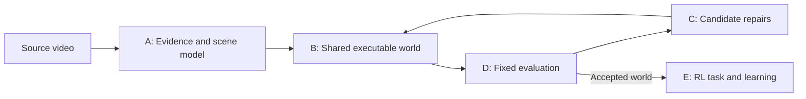

# Weft: one video to an interactive RL environment

## Target and evidence boundary

Input: a physical video, with optional task intent or calibration information clearly identified as additional input. Output: an executable shared world, an RL task interface, and evidence of what was reconstructed and tested. A rendered replay is an evaluation artifact, not the environment itself.

Preserve the user's full scope: whole-video context; primary and secondary objects; object relationships and constraints; per-object state and behavior; alternate viewpoints; physics estimation and testing; competing environment hypotheses; independent grading; and a usable RL environment. Website workflows remain future work. Animals, articulated bodies, and deformable materials remain longer-term physical scope, not rejected requirements.

One observed trajectory does not uniquely identify all hidden geometry, forces, masses, material properties, or intent. Mark each property as observed, inferred, assumed, or unknown and tie observations to source evidence. Generated viewpoints and changed-action predictions are hypotheses unless independently checked.

## Working architecture

Object-focused passes may refine the same world. Do not create independent dog/ball/tree simulations and splice their videos together. All objects share coordinates, time, identities, contacts, and physical constraints. Static objects need state and collision roles, not independent action policies.

Keep appearance, physics, and actor behavior separate. Use an established physics engine when expanding to multi-object rigid bodies. The current numerical 1D engine is a fixture, not a new general-purpose physics engine.

## Implemented contracts and replacement boundaries

These describe working code, not unimplemented abstract interfaces. `run-config.json` uses schema version 1; existing world/evidence formats are identified by their preserved implementation snapshot and must be migrated explicitly if changed.

| Stage | Entry point | Inputs → outputs | Boundary |
| --- | --- | --- | --- |
| A: observe | `vision.analyze(path, out, config)` | Local video → source identity, per-frame measurements/visibility, generation/development/audit partitions | Currently one color/shape tracker. No language understanding, segmentation foundation model, multi-object association, or metric 3D pose. |
| B: generate | `world.generate(evidence)` | Generation partition → validated `World` and object graph | One dynamic circle, inferred static support, appearance-only background. Units are image widths and seconds. |
| B: step | `world.advance(world, x, velocity, action, dt)` | State + bounded action → next state | One shared 1D engine. A derived rotation illustration is not a recovered angular state. |
| C: improve | `repair.repair(world, generation, validation, extra_proposals)` | Generation observations + bounded parameter proposals → selected world and decision ledger | At most three proposals; only `v0` and `drag` are writable. Proposers do not receive the audit pass. |
| D: grade | `evaluate.replay_metrics`, `physics_checks`, `audit_episode` | World + frozen observations/checks → separate score records | Development feedback selects repairs. Audit runs afterward. No model-only truth oracle. |
| E: learn | `RollingEnv`, `learning.train`, `evaluate_policies` | World + authored task → trained Q-table, matched trials, success metrics | Actions: left/coast/right. Observations: target error and velocity. Position and speed determine success independently of reward. |
| Orchestrate | `pipeline.run`, `experiments.run_experiment` | Validated settings and pinned source → new artifact directory | Local by default; failure is explicit; old runs are never overwritten. |
| Compare | `compare.compare_runs` | Two verified artifact sets → metric differences and compatibility reasons | No overall winner when inputs, grader, or task are incompatible. |

The same model can interpret video and propose changes; using different model names alone does not make grading independent. Evaluator code, evidence, and success definitions remain outside the repair interface.

## Future general scene contract

Before replacing the fixture, specify and validate:

- **Scene:** coordinate conventions, units/calibration, camera, timebase, gravity, boundaries, evidence partitions.
- **Object:** persistent ID; role (static/passive/active); render and collision geometry; pose/velocity or joint state; material hypotheses; visibility; evidence references.
- **Relationship/event:** participant IDs, type, time interval, contact or joint constraint, supporting evidence, confidence and alternatives.
- **World candidate:** initial state, shared dynamics/behavior configuration, parameter uncertainty, permitted changes, version/provenance.
- **Task:** controlled actor, observation/action spaces, goal, reward, success, reset distribution, termination versus time limit, provenance of authored additions.
- **Evaluation:** immutable observations and success rules, per-category metrics, tolerances, unsupported scenarios, costs, latency, and failure reasons.

Do not infer new physical evidence from agreement between generated environments. Candidate disagreement suggests a useful experiment. Without an observed outcome, retain the uncertainty. A plausible dog jump is not proof of that dog's true response.

## Evaluation levels

1. **Observed replay:** match positions, identities, motion, event timing, and eventually silhouettes/contact events—not only pixels.
2. **Physical consistency:** test supported dynamics, constraint tolerances, and numerical stability. Passing a synthetic analytic test proves only that tested engine behavior.
3. **Interventions:** prove actions affect the simulation. Label assumed controls; require real trials for claims about real changed-action behavior.
4. **RL utility:** compare learning with baselines under a fixed evaluation task/world. A high score in a convenient generated world is not physical transfer.
5. **External validation:** new physical observations or intervention trials not exposed during generation/repair. This level is not yet implemented.

For benchmark runs, split evidence before exposing it to generation. If the whole source has already been inspected, call its reserved portion a development audit, not an untouched final test. The current second ball pass is exactly such an audit: its first three detections initialize the state, and later detections are scored.

## Deliberate first milestone

The first product milestone remains a few interacting rigid objects in a short fixed-camera scene, one controlled actor, a shared physical world, bounded repairs, and real RL learning. Tabletop pushing/sorting versus ball collisions is not yet a user-selected decision. The existing single-ball clip verifies plumbing and iteration mechanics only.

Meta integration is planned for perception/interpretation and evidence-grounded proposals. The existing optional adapter offers only one parameter proposal and has no live verification. It does not establish meaningful end-to-end Meta use or hackathon readiness.
