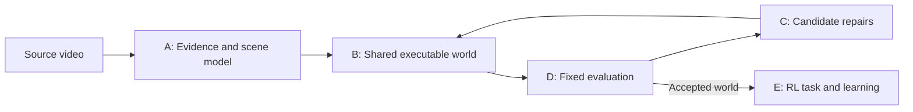

# Weft: one video to an interactive RL environment

**Product entry point:** [the local web portal](portal.md) owns video uploads, bounded background jobs and server-side OpenAI analysis, then calls the existing exercise/shared-world or rigid-scene builders and mounts the existing lab for interaction/recording. It does not use a ChatGPT login or execute model-generated commands. [Implementation and acceptance](handoffs/portal-api.md).

**Muse review:** completed projects can queue a server-key Meta construction critique through the same portal. Evidence-linked hypotheses, alternatives, suggested tests and costs remain outside immutable runs; no evaluation data is sent and no proposal is automatically applied. [Live acceptance and remaining repair-loop work](handoffs/portal-muse.md).

**Related local experiments:** fixed control comparisons run under the original task, with bounded background work, full traces and exact replay. Muse's requested physical measurements remain unresolved. Diagnostics do not apply repairs or change scorers. [Verification](handoffs/portal-checks.md).

**Authored support variants:** the portal can reuse a sealed body to build a separate coupled support world, optionally train, and record/replay. Explicit box/load assumptions define a new task, not a repaired parent score. Construction repeats no AI or pose inference. New [Muse reviews include the actual world assumptions](handoffs/portal-world-review.md); existing body-only reviews keep their original scope. [Verified workflow and limits](handoffs/portal-support-experiments.md).

For the full product target and physics-grounded evaluation design, read [goal.md](../goal.md). For the first product milestone, read [v1.md](../v1.md). This document maps those targets to the current implementation contracts and limitations.

## Target and evidence boundary

**October 28 local expansion:** the [local lab](local-lab.md) implements explicit profiles: original rolling, colored or manually selected appearance-region planar scenes (Pymunk), and exercise-pose-to-articulated-human scenes (MediaPipe + MuJoCo). The historical contract table below describes the original rolling path; it is not the complete current implementation inventory. [Lab verification](lab-verification.md) separates real-video pose evidence, synthetic tabletop checks, and simulated RL results.

Input: a physical video, with optional task intent or calibration information clearly identified as additional input. Output: an executable shared world, an RL task interface, and evidence of what was reconstructed and tested. A rendered replay is an evaluation artifact, not the environment itself.

[Parallel ownership](parallel-workstreams.md) separates video understanding/reconstruction (Track A) from simulation/RL/lab integration (Track B). Both use the same versioned evidence/world boundary; objects and exercises are validation cases, not separate products. Existing schemas are adapters, not proof that a universal world representation is complete.

Preserve the user's full scope: whole-video context; primary and secondary objects; object relationships and constraints; per-object state and behavior; alternate viewpoints; physics estimation and testing; competing environment hypotheses; independent grading; and a usable RL environment. Website workflows remain future work. Animals, articulated bodies, and deformable materials remain longer-term physical scope, not rejected requirements.

One observed trajectory does not uniquely identify all hidden geometry, forces, masses, material properties, or intent. Mark each property as observed, inferred, assumed, or unknown and tie observations to source evidence. Generated viewpoints and changed-action predictions are hypotheses unless independently checked.

## Working architecture

Object-focused passes may refine the same world. Do not create independent dog/ball/tree simulations and splice their videos together. All objects share coordinates, time, identities, contacts, and physical constraints. Static objects need state and collision roles, not independent action policies.

Keep appearance, physics, and actor behavior separate. Use an established physics engine when expanding to multi-object rigid bodies. The current numerical 1D engine is a fixture, not a new general-purpose physics engine.

## Implemented contracts and replacement boundaries

The [coupled shared-world runtime](shared-world.md) combines articulated bodies and rigid objects in one MuJoCo model/clock, with lab controls and exact recording. `shared_world_evidence.py` verifies exact documents, full source coverage and canonical-frame partition consistency; `source_equivalence.py` admits complete verified original/derivative mappings without relabeling identities or clocks. `shared_world_packaging.py` preserves the complete proof in labs and trained outputs. `shared_world_pipeline.py` and `shared_world_reconstruction.py` now build source-linked equipment collision proxies from explicit geometry proposals, with optional recorded coordinate-frame migration. Camera/depth, physical shape, hand support, useful exercise learning and generalized reconstruction remain open. See the [combined handoff](handoffs/combined.md) for scoped evidence and failures.

The [human-only exercise task](shared-exercise.md) uses this same physical world, forbids object-force actions and measures tracking/equipment stability throughout the interval. Optional wrist-region requirements are explicit, not recovered grasp. `shared_world_observation.py` preserves solver-versus-integrated substep clocks; `shared_exercise_recording.py` and `shared_exercise_run.py` provide versioned recording, baseline evaluation and exact action replay. `shared_exercise_lab.py` seals an explicit task into a new lab with manual/coast/reference controls, whole-interval results and recording; old labs keep their task. The five-stage inspector exposes bounded saved evidence without creating another simulator.

`equipment_proposal.py` turns explicit camera/shape priors and canonical saved observations into an initially admitted proposal without study-directory dependencies. `exercise_scene_pipeline.py` chains those existing stages into one [assembly command](equipment-proposals.md), retaining unsupported and partial outcomes. `shared_exercise_learning.py` trains grouped human feedback gains and evaluates a frozen policy separately; optional policy/evaluation attachments retain exact recording provenance and truthful baseline labels. The first source search selected unchanged authored control, and changed-start evaluation exposed an equipment-reset flaw. Neither implementation establishes useful whole-exercise learning or physical accuracy.

These describe working code, not unimplemented abstract interfaces. `run-config.json` uses schema version 1; existing world/evidence formats are identified by their preserved implementation snapshot and must be migrated explicitly if changed.

| Stage | Entry point | Inputs → outputs | Boundary |
| --- | --- | --- | --- |
| A: observe | `vision.analyze(path, out, config)` | Local video → source identity, per-frame measurements/visibility, generation/development/audit partitions | Currently one color/shape tracker. No language understanding, segmentation foundation model, multi-object association, or metric 3D pose. |
| B: generate | `world.generate(evidence)` | Generation partition → validated `World` and object graph | One dynamic circle, inferred static support, appearance-only background. Units are image widths and seconds. |
| B: step | `world.advance(world, x, velocity, action, dt)` | State + bounded action → next state | One shared 1D engine. A derived rotation illustration is not a recovered angular state. |
| C: improve | `repair.repair(world, generation, validation, extra_proposals)` | Generation observations + bounded parameter proposals → selected world and decision ledger | At most three proposals; only `v0` and `drag` are writable. Proposers do not receive the audit pass. |
| D: grade | `evaluate.replay_metrics`, `physics_checks`, `audit_episode` | World + frozen observations/checks → separate score records | Development feedback selects repairs. Audit runs afterward. No model-only truth oracle. |
| E: learn | `RollingEnv`, `learning.train`, `evaluate_policies` | World + authored task → trained Q-table, matched trials, success metrics | Actions: left/coast/right. Observations: target error and velocity. Position and speed determine success independently of reward. |
| Orchestrate | `pipeline.run`, `experiments.run_experiment` | Validated settings and pinned source → new artifact directory | Local by default; failure is explicit; old runs are never overwritten. |
| Compare | `compare.compare_runs` | Two verified artifact sets → metric differences and compatibility reasons | No overall winner when inputs, grader, or task are incompatible. |

The same model can interpret video and propose changes; using different model names alone does not make grading independent. Evaluator code, evidence, and success definitions remain outside the repair interface.

## Future general scene contract

The planar profile has strictly validated `planar-rigid-v1` and opt-in [oriented-support `planar-rigid-v2`](oriented-supports.md) contracts in `scene.py`, and exercise has versioned `exercise-v1` / `exercise-v2` body contracts in `human.py`. Neither is a universal scene representation. The original `World` format remains intact behind a lab adapter; do not feed exercise poses into the planar contract or claim a migration to one general schema. V2 retains normalized length and relative mass; rotated supports and friction inputs do not establish video calibration or physical fidelity.

Experimental `ramp_inference.py` constructs an affine camera-plane hypothesis from two source support lines and a declared ramp angle, fits bounded prefix motion and retains a friction/scale family. The [source-derived ramp study](source-ramp-reconstruction.md) freezes nine executable scenes before complete later-frame comparison. Effective box heights impose initial support contact; camera calibration, materials and target mass remain unknown. Later collision errors reject automatic promotion or a physical-accuracy claim.

Experimental `spatial_rigid.py` adds the separate [3D `spatial-rigid-v1` contract](spatial-rigid.md): up to twelve validated box/sphere primitives, MuJoCo contacts, complete 13-value/object observations and eight bounded virtual-force actions. `scene-sandbox` and recording dispatch by explicit profile; existing planar/human paths remain separate. Recordings preserve orientation, world angular velocity and contact details within a 16 MiB journal. The offline viewer parses history in a worker, coalesces frame requests and limits updates to the selected state; static wireframe supports prevent inspection occlusion. Additional source-camera evidence motivates 3D representation, but authored depths/materials and observed collision mismatch prevent physical promotion. B now provides opt-in `spatial-fixture`, `spatial-lab` and `lab --scene-run` imports into a new sealed lab; imports preserve the source candidate and its unverified physical status.

Experimental `material_fit.py` constructs bounded distinct-contact hypotheses from complete construction-only source slots; it does not consume held-out labels or change scorers. `ramp_transfer.py` initializes a new ramp trial from a fixed opening prefix while preserving camera, geometry, gravity and all materials. The [frozen-repeat study](material-transfer.md) substantially improves center motion but still fails its unchanged accuracy gate and exposes projected-width errors. Constructor, settings, source-only labels and comparison boundaries are sealed separately. No automatic model promotion or ordinary-lab integration follows from a better fit.

Experimental `affine_camera.py` fits all supplied construction correspondences without point rejection, retaining degeneracy checks and camera/shape ambiguity. `orthographic_shape.py` proposes one dimension change under an explicit scaled-orthographic camera assumption, not measured geometry. The [two-view rigid comparison](conditional-rigid-camera.md) preserves manual corner provenance, both depth-axis assignments and complete source slots; its front-only gain regresses in the side view. Neither helper changes ordinary lab construction or the independent scorers.

Experimental `surface_features.py` extracts bounded image-texture descriptors inside supplied masks and matches directly to an unchanged initialization. Raw points, duplicate orientations, unavailable observations and ambiguous matches remain separate. The [five-view feature study](surface-feature-diversity.md) retains every source slot, including textureless-ball failure and lost rigid-object correspondences. Appearance pairs do not verify physical point identity, rigidity, joints or calibration; no automatic lab integration or geometry promotion follows from match counts.

Experimental `feature_tracks.py` adds [bounded adjacent-frame histories](feature-track-diversity.md), with unchanged original-reference checks, explicit births/breaks and conflict splitting. It stores only original/previous features and active links; callers journal full history. More local appearance links do not restore every opening anchor, identify physical points or qualify source edits. It does not replace ordinary lab tracking or infer a new scene.

Experimental `track_shape.py` attempts relative 3D visible-point shape from complete bounded track windows under an explicit scaled-orthographic camera model. It preserves incomplete observations and rejects inadequate depth motion, ambiguous metrics and inconsistent projections. The [five-view study](track-shape-diversity.md) retains all 140 windows but qualifies no real shape proposal; known 3D controls pass while coherent scale deformation remains indistinguishable from camera scaling. It exports neither anatomy nor collision geometry and does not modify existing worlds or lab defaults.

Experimental `point_flow.py` adds immutable-seed optical flow with local reverse checks and original-patch affine alignment. The [five-view study](point-flow-diversity.md) has 0.051-pixel maximum known-warp error but worse real-video coverage; all original real points end and none of 179 windows qualifies a shape. It remains opt-in research, with no default or scene promotion.

B's `environment-capabilities-v1` describes current actions, observations, controlled actors and unsupported features across existing profiles. `capabilities --run` inspects it; actor switching preserves the scene, with recording/policy guards. `spatial-train` supplies bounded CEM policy fitting and matched changed-initial-condition baselines; `body-evaluate` keeps original whole-body success/floor gates. Improved return is not task success or physical accuracy. `replay --recover-incomplete --out` recovers validated events into a new directory without changing the crash source. [B implementation, checks and limits](handoffs/agy.md).

The former A-only checkpoint's mixed-body restriction is historical: both tracks now share the implemented `shared-world-v1` runtime and verified source/recording boundaries described above. Rigid `scene_width` and human model units still do not become metres through a new label. Software contact/replay checks do not establish physical parameter accuracy, hand support or generalized reconstruction.

`world_evidence.py` now validates complete source slots and qualified identities across existing observation documents, then exports only authorized construction evidence while retaining withheld stubs. `world_alignment.py` separately validates explicit proper coordinate/clock hypotheses and derivative conversions; it never guesses missing scale or origin. [The saved-source study](world-construction-boundary.md) verifies five documents / 860 frames / 1,266 slots and reserved-data non-interference. These A-owned helpers prepare B's boundary; they do not instantiate a mixed simulator or infer person/object correspondence.

Before replacing the fixture, specify and validate:

- **Scene:** coordinate conventions, units/calibration, camera, timebase, gravity, boundaries, evidence partitions.
- **Object:** persistent ID; role (static/passive/active); render and collision geometry; pose/velocity or joint state; material hypotheses; visibility; evidence references.
- **Relationship/event:** participant IDs, type, time interval, contact or joint constraint, supporting evidence, confidence and alternatives.
- **World candidate:** initial state, shared dynamics/behavior configuration, parameter uncertainty, permitted changes, version/provenance.
- **Task:** controlled actor, observation/action spaces, goal, reward, success, reset distribution, termination versus time limit, provenance of authored additions.
- **Evaluation:** immutable observations and success rules, per-category metrics, tolerances, unsupported scenarios, costs, latency, and failure reasons.

Do not infer new physical evidence from agreement between generated environments. Candidate disagreement suggests a useful experiment. Without an observed outcome, retain the uncertainty. A plausible dog jump is not proof of that dog's true response.

`spatial_scene_inputs.py` and `spatial_scene_pipeline.py` connect sealed planar
video scenes to the existing 3D lab through `spatial-scene`. They archive the full
input and preserve front geometry, identity, colors and inherited planar spin.
Depth, lateral placement, materials and task remain explicit authored choices;
the package is not admitted until ordinary `spatial-lab` checks run. Known video
metadata migrations retain exact media and original sidecars. No old planar
policy is reused and no physical equivalence is claimed.
[Construction contract and commands](spatial-scene-construction.md).

## Evaluation levels

1. **Observed replay:** match positions, identities, motion, event timing, and eventually silhouettes/contact events—not only pixels.
2. **Physical consistency:** test supported dynamics, constraint tolerances, and numerical stability. Passing a synthetic analytic test proves only that tested engine behavior.
3. **Interventions:** prove actions affect the simulation. Label assumed controls; require real trials for claims about real changed-action behavior.
4. **RL utility:** compare learning with baselines under a fixed evaluation task/world. A high score in a convenient generated world is not physical transfer.
5. **External validation:** new physical observations or intervention trials not exposed during generation/repair. This level is not yet implemented.

For benchmark runs, split evidence before exposing it to generation. If the whole source has already been inspected, call its reserved portion a development audit, not an untouched final test. The current second ball pass is exactly such an audit: its first three detections initialize the state, and later detections are scored.

## Deliberate first milestone

The original rigid-body milestone remains relevant, but the user now explicitly prioritizes exercise videos with a 3D body, joints, and illustrative muscles. The local implementation provides anchored hinge/spatial bodies and an explicit mobile model with authored floor contacts and root forces. The separate whole-body terminal mode learns reference-conditioned 22-motor feedback and records every completed step. None establishes anatomy recovery, measured muscle forces, calibrated physical balance or autonomous exercise learning. Tabletop objects/balls remain a supported development profile, not the only product direction.

Meta scene advice is implemented as construction-only evidence questions with validated, untrusted hypotheses and required tests. Both live adapters share a durable aggregate budget ledger; the user approved $5 total. Project-local key access and bounded Muse Spark/SAM calls are verified; [live results](meta-advisor.md) retain failures, usage and unaccepted hypotheses. The shared observations format preserves identity/units/visibility/relationships and saved SAM proposals with decoder timestamps and unresolved identity groups; it does not recover general physical scenes. [Current diversity evidence](diversity-verification.md) separates ten executable environments from three real-input failures and unverified physical accuracy. Neither integration scaffolding nor prepared requests establish meaningful live Meta use or hackathon readiness.

## Local lab boundaries

`lab.py` starts one bounded `lab_worker.py` subprocess and a token-protected loopback HTTP viewer. Training and manual interaction use the same Python physics implementation. The browser renders snapshots only; it does not implement a separate physics engine. Status polling is bounded and stops when complete; hidden pages pause interaction. Completed `run/` artifacts are immutable by workflow; append-only action/state journals and exports use new `sessions/` directories.

`lab_console.py` is a terminal adapter for the same admitted lab, task, controls and recording/export implementation. It starts neither a pipeline worker nor a server, advances only on explicit bounded step commands, and preserves seeded resets and controller identities. `build_sandbox.py --console` enters it only after a ready build and saved inspection report. [Terminal workflow](local-lab.md#interact-and-record-in-the-terminal).

`source_frame_pixels.py` extracts selected original frames from a byte-verified source in one supervised decoder child. `pose_pixel_support.py` compares local patch motion with saved pose estimates; `pose_pixel_support_package.py` binds the diagnostic to exact source receipts/images. `exercise_build_report.py` optionally displays that saved companion without rematching pixels. Unknown texture, identity, occlusion and clocks remain unavailable, and neither local image agreement nor a disagreement modifies poses, quality gates, physics or task success.

`exercise_coverage.py` derives a bounded display-only snapshot from terminal pose/root artifacts. The authenticated `/api/exercise-coverage` endpoint schedules one background read and reuses it for that immutable lab session; large pose files never enter ordinary status polling. The Video tab shows analyzed/partial/unusable/unsampled counts and source-seeking issue markers, including rejected runs. It neither repairs poses nor changes body admission, scoring, physics or recording.

`scene_vision.py` detects configured/distinct colored objects and fits bounded damping candidates plus one construction-only [initial-speed proposal](initial-motion.md) under fixed later-frame, per-object checks. Starting geometry and task definitions remain unchanged. `scene_learning.py` evaluates learned/random/coast policies on one fixed scene. `exercise_vision.py` preserves local CPU pose landmarks, confidence, missing frames, model identity, and input limits. `human.py` maps pose-derived proportions/angles into repository-authored MuJoCo templates; `human_learning.py` learns one authored joint-target task. `recording.py` preserves action/state traces and produces fully decoded video plus offline replay. No untrusted generated code is executed and no external inference service is used by the lab.

Experimental `pose_crop_selection.py` considers original-neighbor crops only for unusable poses or clear short torso reversals, preserving originals and rejecting lost joint support. [Complete-video evidence](selective-crop-exercises.md) covers five existing exercise clips: 13 source-consistent replacements, two playable mobile-body candidates, two competing-hypothesis rejections and one long-root-gap rejection. Native-body labeled accuracy is unchanged; contact remains unverified. The selector is not a default or ordinary lab inference option.

`generic_vision.py` tracks explicit source-pinned regions without color masks and adapts them to the existing planar scorer; it does not discover objects or recover their forces. `body_frame.py` fits a fixed camera-relative torso orientation that affects actual dynamics. Exercise inference mode is explicit (`video` default, `image` alternative), with unchanged ambiguity rejection. [Follow-up evidence](iteration-followup.md) preserves the mode regression, remaining servo failure and grayscale-source limitations.

The explicit spatial body uses `spatial_pose.py` for provenance-preserving 19-axis references, with dynamic torso orientation but anchored translation. Its servo metric is versioned separately from legacy 8-axis coordinates; independent original-view limb labels expose residual identity flips. [Spatial evidence](spatial-human.md). Compact viewer metadata references the full saved human model instead of repeating all evidence on UI state responses.

`whole_body.py` exposes `exercise-imitation-v1`, a 155-value observation and 22 normalized direct motor actions. `whole_body_learning.py` performs bounded, multi-window policy search; the scorer remains in the environment, outside policy weights. `whole_body_console.py` provides manual/learned/authored actions and complete recording. [Whole-body contracts and multi-seed results](whole-body-learning.md). Floor failures remain visible even when tracking reward improves.

`foot_body.py` attaches an opt-in two-capsule/six-axis ankle candidate without changing original body/root/floor references. `foot_sandbox.py` exposes the distinct `exercise-feet-posture-v1` Gym task: 85 observations, 28 direct motor actions and an authored starting-pose target, not source-motion imitation. Missing exact-time foot poses remain unscored, and missing starting feet prevent initialization. [Candidate audit, interactive CLI and recordings](foot-sandbox.md). All real candidates remain unpromoted because of missing evidence or floor conflicts.

`foot_candidate.py` exposes `feet-build` from a verified mobile video run, with exact copied input bytes and a separate sealed output. Optional `foot_image_refinement.py` rotates available fixed foot triangles at most 15° toward source-image directions; depth, shape, body, root, floor and missing samples stay unchanged. Repeated correction is rejected. The [four-source comparison](foot-image-refinement.md) improves some visual/floor checks but qualifies no physical model.

The optional [ground-orientation hypothesis](ground-orientation.md) changes the actual mobile floor and gravity while preserving camera-relative references. All four tested source-foot estimates failed the authored screening limits; no real model was changed. Separate analytic interaction/recording checks verify the tilted-plane implementation, not recovered physical accuracy.

`segmentation_masks.py` decodes saved original Meta masks in a bounded spawned worker and exports exact-frame inspection previews plus binary silhouettes. The offline viewer loads only the selected frame and retains source clocks, raw identities, missing slots and uncertainty. [Three-source evidence](decoded-masks.md) includes a descriptive exercise pose/silhouette comparison; neither model agreement nor decoded geometry is automatically promoted into anatomical or collision geometry.

`camera_reference.py` compares frozen twelve-joint pose outputs with an explicitly supplied camera/3D reference. It validates rotations/projection, preserves every unavailable slot and removes only each pose's own hip midpoint; no alignment parameters are fitted. Reference data stays outside generation/repair. The [moving-camera jogging study](multiview-jog.md) verifies executable recording while retaining missing poses, 3D disagreement and floor failures; third-party reconstructed references do not establish independent physical truth.

`camera_pose.py` instead uses explicitly supplied camera transforms during construction: fixed-scale image/world joint pairs estimate root translation, then camera motion is removed. Provider body references remain outside fitting. `camera_body.py` binds source/calibration/reference hashes into an opt-in ±50-unit world-coordinate mobile body. `camera_body_lab.py` packages the separate manual lab, full coverage, immutable originals and unchanged floor audit, without training or transferring a policy. View-following changes projection only. [Actual jogging results and recordings](camera-aware-body.md) show improved root travel but worse floor intersections; legacy whole-body training and raw-camera foot adapters reject this new coordinate mode explicitly.

`camera_ground.py` accepts optional source/calibration-bound horizontal ground as additional input. Only the world-to-simulation height offset changes; first-pose floor fitting is then prohibited. Native sphere/capsule clearances are reported separately from the unchanged penetration scorer and are never labeled contact evidence. [Ground-aware results](camera-ground.md) verify unchanged world body points while exposing floating and inverted estimates. Passing this collision check does not promote the body or enable training.

`multiview_pose.py` constructs per-joint 3D positions from two source/clock-bound calibrated image rays, never monocular world landmarks or provider body references. Confidence, image bounds, ray angle, forward depth and reprojection guards retain all missing/rejected slots. [The two-view development study](multiview-pose.md) improves paired comparison-camera agreement but leaves an incomplete skeleton; original-clip synchronization is explicitly assumed. Complete image-supported limb/body reconstruction remains unavailable where endpoints are hidden or inconsistent.

`multiview_root.py` provides an explicit [root-only body candidate](two-view-root.md): both triangulated hips are required at every original body pose, with no fallback or dropped poses. It changes world root position and the origin/base-height offsets, retaining the exact monocular shape, forces, ground, angles and missing slots. Nested source/camera/clock/shape bindings and copied inputs preserve provenance. `camera-body --root-view` packages the manual lab and independent checks without training or physical promotion; raw monocular estimates remain separate.

`multiview_body.py` adds a separately bound [partial geometry candidate](two-view-body.md): source-supported median dimensions and complete torso/three-point limb directions, with explicit monocular local-angle priors for missing groups. `camera-body --body-view directions|dimensions|both` preserves the root-only parent and unchanged root/ground/support settings, without weakening that parent's validation. Changed lengths alter authored mass/inertia; symmetry and hidden-limb priors remain assumptions. The UI uses compact per-group coverage metadata, not repeated full-audit downloads. Three-way development comparison retains wrist/max-error regressions and no physical promotion.

`multiview_segments.py` adds opt-in [v2 upper-segment transport](two-view-segments.md) through `--partial-segments`: a separate pass uses available proximal pairs while preserving v1 complete-limb angles, dimensions, root and ground. Missing endpoints remain unavailable; transported twist and distal bends retain explicit monocular provenance. Coupled angle confidence is zero, with image-pair confidence recorded separately. Native invariants and exact recording pass, but substantial individual regressions prevent automatic promotion or physical claims.

`limb_correspondence.py` separately tests short parent-supported temporal left/right assignments using original two-view image rays. It preserves raw predictions, rejected windows and missing slots, excludes comparison references and never reuses repaired anchors. It is not connected to body generation: both real jogging studies abstain on every candidate window. `pose_densify.py` adds only uncached IMAGE-mode observations under exact video/model/runtime bindings, retaining cached observations and quality failures. The [every-frame study](dense-exercise-poses.md) exposes an inconsistent hip pose; the unchanged root contract rejects the denser body without interpolation or dropped poses.

`pose_crop.py` offers a distinct [image re-inference candidate](temporal-crop-recovery.md): original temporal neighbors define one bounded crop in each source image, triggered by inconsistent two-view hip rays. The same local model produces new image/world hypotheses; calibrated-ray, retained-support and original-neighbor root checks govern acceptance. Raw observations, all rejected proposals, exact source clocks and derivation hashes remain separate, and body-reference metadata retains the crop provenance. The new jogging body preserves 224 poses/16 unavailable frames and exact recording, but does not establish accurate contact, identity or anatomy. Neither sampling nor the default inference path silently enables this method.

`exercise_vision.py` accepts byte-pinned Lite and explicit Full/Heavy model bundles; `fetch-pose-model --variant full|heavy` does not change the Lite default. The [four-input Full comparison](full-pose-model.md) preserves complete sample clocks and visibility regressions. The later [five-input Heavy comparison](heavy-pose-model.md) improves exposed image-direction checks but loses usable poses, and only squat meets body-construction prerequisites; its separately recorded body still fails floor checks. Camera-body packaging accepts a sealed authored task proposal when a source policy does not exist, enabling an untrained manual candidate without fabricated weights or repeated inference. Full fixes an inversion but retains ground gaps. Partial two-view integration now exists; independently validated complete anatomy, contact and whole-exercise control do not.

Experimental `body_pixel_refinement.py` fits source-image joint positions through actual MuJoCo derivatives, with unchanged body dimensions, source-bound root/scale, floor and motor limits. Confidence/crop gates, bounded angle corrections and retained uncertainty do not identify depth or contact. The [five-body comparison](body-pixel-refinement.md) preserves all 484 references but exposes floor and independent limb-direction regressions, so no default or sandbox is replaced. This remains an explicit study path, not automatic physical repair.

New appearance and colored-object runs use [full-interval reconstruction planning](full-interval-reconstruction.md): complete declared frame accounting, chronological evidence partitions, continuous simulation across missing frames, and a small coverage summary in the lab. This removes silent first-episode/time-cap selection without recovering unobserved positions or weakening replay gates.
