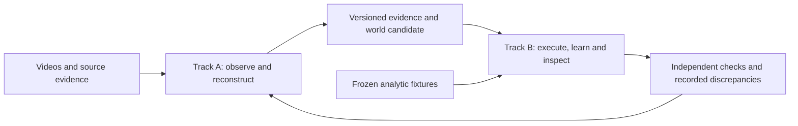

# One Weft system, two parallel workstreams

## Objective and assignments

Build one generalizable **video → evidence → executable shared world → RL task → inspection/recording** system. Balls, tabletop scenes and exercise videos are validation cases, not separate products. Existing profile-specific engines are implementation adapters; they must not become disconnected pipelines or independent worlds for objects in the same scene.

| Track | Owner | Owns | Does not own |
| --- | --- | --- | --- |
| A — Video understanding and scene reconstruction | **Codex, this session** | Source acquisition/provenance, segmentation/pose observations, tracking/identity, camera and shape inference, evidence-backed world candidates | Lab UI, runtime/session dispatch, recording implementation, reward definitions or independent graders |
| B — Simulation, RL and the unified lab | **agy, teammate/session** | Executable environment adapters, constraints/contacts, RL task/control interfaces, lab/session integration, inspection and recordings | New tracking/pose/camera algorithms, re-labeling source evidence, new source acquisitions or duplicating A's experiments |

Track A's autonomous development is currently **paused at the user's request**. Handoff and repository checkpoint preparation are separately authorized. Track B can begin independently when the user starts the other session; it does not need A to resume. Start with the [self-contained agy handoff](../AGY_HANDOFF.md).

## The dependency boundary

**B starts now against existing validated scene formats and analytic fixtures.** A improves reconstruction against the same boundary. Neither waits for perfect perception, invents another scene format privately, or claims synthetic fixtures prove physical accuracy.

Current interfaces are real but **not yet one universal world schema**:

- `observations.py`: `scene-observations-v1`, schema versions 1–3. Preserve source hashes, original clocks, units, object IDs, visibility, evidence partitions and observed/inferred/assumed/unknown claims. Complete observation exports include evaluation evidence; filter before supplying a reconstruction/repair model.
- `scene.py`: `planar-rigid-v1/v2`; `spatial_rigid.py`: `spatial-rigid-v1`; `human.py`: `exercise-v1/v2/v3`. Consume their validators and explicit units; do not reinterpret normalized lengths or model coordinates as calibrated meters.
- Gym-compatible environments expose `reset`/`step`; saved snapshots, action definitions, termination and task semantics remain explicit. Kinematic replay, authored servo, learned policy and physical simulation remain distinct.
- Completed `run/` artifacts are immutable. Mutable lifecycle status and new `sessions/` recordings remain outside their seals. A new evidence/model/profile version requires explicit migration, not mutation of old artifacts.

A cross-track API/schema change requires a short proposal in this file: exact fields/signatures, owner, migration and contract tests. Coordinate it before editing. Until agreed, use existing contracts and opt-in adapters.

## File ownership

### A: exclusive implementation area

`src/weft/*vision.py`, `observations.py`, `segmentation_evidence.py`, `segmentation_masks.py`, `segmentation_observations.py`, `surface_features.py`, `feature_tracks.py`, `regional_features.py`, `joint_tracking.py`, `pose_*`, camera/triangulation/correspondence modules, and source-derived reconstruction/fit studies. Corresponding source-label metadata, focused tests and study docs belong to A.

Do not change B-owned `human.py` to add an inference experiment: place construction adapters in A-owned modules and use the existing body validator. Likewise, scene-parameter inference must not rewrite B's simulator or independent evaluator.

### B: exclusive implementation area

`src/weft/lab.py`, `lab_worker.py`, `cli.py`, `recording.py`, `scene_console.py`, `scene.py`, `spatial_rigid.py`, `human.py`, environment/control/learning adapters, `whole_body*.py`, and `src/weft/assets/lab.*` / `spatial-replay.html`. Corresponding runtime, HTTP, recording and mocked-UI tests belong to B.

Public schemas/signatures in these files are frozen across tracks until coordinated. B may improve implementation without reclassifying inferred source values as measured facts or changing fixed accuracy gates.

### Coordinated files, one writer at a time

`AGENTS.md`, `README.md`, `TODO.md`, `goal.md`, `v1.md`, `docs/architecture.md`, `docs/iteration.md`, this workstream contract, `pyproject.toml`, dependency locks, `pipeline.py`, shared I/O, provider/budget adapters and independent scoring code. The integrator owns these edits; request the specific change instead of racing another session. Do not silently edit another track's files under a broad glob above; declare any ambiguous ownership first.

Each track keeps its own handoff note and uses **new** experiment directories, e.g. `artifacts/track-a-<study>-01` and `artifacts/track-b-<study>-01`. Never share a mutable output directory, reuse another job's lease, rerun a live job, or install dependencies while another session is using that environment.

## Parallel operation and Git checkpoints

- Prefer separate local checkouts. This repository currently requires work on `main` and no new named branches without an explicit user request; this handoff does not silently override that rule. Do not create branches/worktrees here as part of reading it.
- Assign exact files before editing. Only the designated integrator publishes to shared `main`; other sessions deliver a reviewable diff/commit and test evidence. Observe the repository's approval rules. No force-push, history rewrite, deployment or unrelated cleanup.
- At a meaningful completed/tested milestone, and before a session handoff, commit/push the authorized checkpoint rather than accumulating days of dirty work. Reuse passing checks whose inputs are unchanged. Check remote state before integration and verify it afterward.
- Keep secrets, environments, model caches and generated runs out of Git. Retain source attribution and required fixtures. Do not delete local evidence to obtain a clean status.
- Inventory stashes before cleanup. Preserve unique changes in a commit or verified local backup, then remove only the reviewed stash under the user's cleanup authorization. Never use blanket `stash clear` or `git clean` to hide unfinished work.
- Meta spend is **one project-wide $5 budget**, not $5 per session/checkout. Last verified total is eight settled calls / $0.186152; the canonical ledger is local. B's first task needs no key or paid call. A second checkout must not create a fresh budget ledger and reuse the key. Coordinate all paid execution through the canonical reservation path; never copy keys into a handoff or Git.

## Mandatory durable handoff

**Both sessions must document critical context as they work so another person can continue without this chat.** A owns `docs/handoffs/track-a.md`; B owns `docs/handoffs/agy.md`. Update at each completed milestone, before a long-running job, when blocked, and before ending a session. Record:

1. Objective, owner, current checkout/branch/revision and timestamp in America/Los_Angeles.
2. Completed versus pending work and exact changed files; distinguish implementation, test verification and real-world accuracy.
3. Decisions and rejected approaches that would otherwise cause repeated work; preserve failures and reasons.
4. Exact commands, configuration, dependencies and artifact/source/manifest identities needed to reproduce the result.
5. Tests/checks with results and remaining limits. Link immutable evidence; never treat a green unit test as a real-world guarantee.
6. Any live process/job handle, ownership/lock, output directory, progress and stop/resume procedure. Re-check liveness; a status file is not proof a job is running.
7. Blockers, cross-track interface requests, budget use and the next safe action.
8. Commit/push/stash state. List any uncommitted work and its owner; do not imply another person can fetch local-only artifacts.

Never include credentials, tokens, private auth state or whole chat transcripts. Keep notes concise and current; archive historical detail by reference rather than repeating it. Promote cross-track decisions into `TODO.md` and this contract through the integrator.

## Completion means the original goal

Neither track independently declares Weft complete. Integration must show the same workflow handling diverse previously untuned videos, complete source/evidence coverage, coherent multi-object/articulated worlds, usable RL controls and learning, recording/replay, and independent accuracy checks—including observed changed-action outcomes for physical-transfer claims. A feature demo, synthetic score or one improved camera view is insufficient. Illustrative muscles need not become medical measurements; their illustrative status must remain clear.
