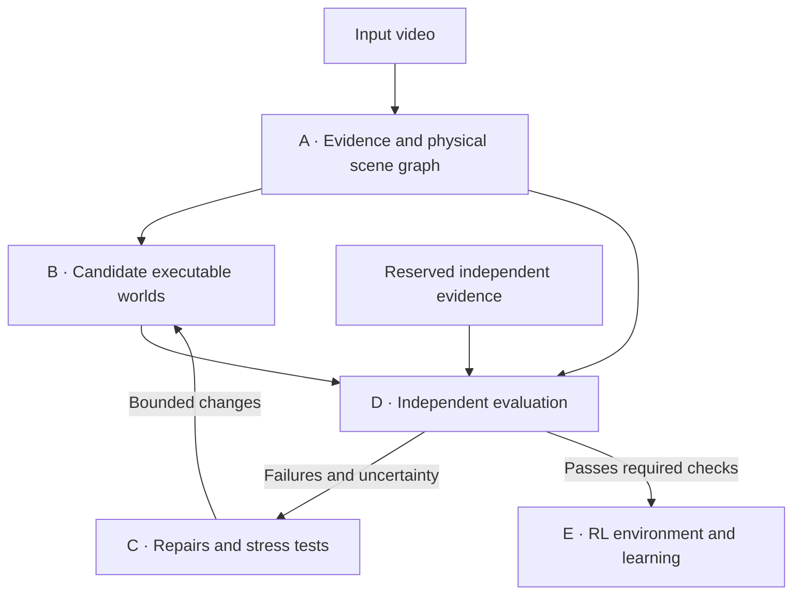

# Weft — from observation to an executable world

**Current product priority (November 2, 2026):** deliver the interactive [web portal](docs/portal.md), backed by server-side AI API keys—not a ChatGPT login or coding-session runtime. Upload → AI analysis → reconstruction/checks → RL simulation → interaction/recording/export must be one user journey. The user approved a separate $5 total OpenAI portal development allowance. Both reconstruction and simulation tracks remain in scope; generalization and physical-accuracy gaps are not waived. Hosted publication remains explicitly deferred.

**Meta integration priority:** Muse Spark is the physical-scene proposer/critic, separate from avatar generation. The portal now exposes construction review; completing bounded repair proposals and independent tests remains part of the full goal. OpenAI planning does not replace meaningful Meta use. [Current evidence](docs/handoffs/portal-muse.md).

Current implementation and the user's exercise-video priority are documented in the [local lab guide](docs/local-lab.md). This file retains the broader product target; the original single-ball status descriptions are historical, not the current feature inventory.

**Current combined assignment — October 29, 2026, 7:04 PM PDT:** the user closed agy's session and transferred Track B into this session. Codex now owns both video understanding/reconstruction and simulation/RL/lab/recording. Use the [complete replacement /goal prompt](docs/handoffs/complete-goal.md), which includes inherited unfinished work, verified evidence, remaining requirements and operating constraints. Earlier A-only/B-only assignments are historical; preserve their implementation without duplicating it. The product target below remains unchanged.

**One video → an object-based world model → an interactive simulator → a trainable RL environment.**

Current implementation and next actions: [combined handoff](docs/handoffs/combined.md). The goal prompt is a dated scope snapshot, not a continuously current cost/process report.

Weft's goal is to turn a physical demonstration into a world an agent can act in, test, and learn from. The world should explain the recording and remain coherent when an agent takes a different action.

**The reconstructed video is evidence of the environment. It is not the environment itself.**

Design originated October 27, 2026; collaboration assignment updated October 29, 2026. This document defines the product target, not a claim that every capability is implemented. Several local rigid/human profiles now exist, but generalized reconstruction remains incomplete; see [implementation architecture](docs/architecture.md) and [verified status](TODO.md).

[First-version scope](v1.md) · [Hackathon pitch](hackathon/pitch.md) · [Iteration workflow](docs/iteration.md)

---

## The product goal

**Input:** one video of a physical scene. Optional intent, measurements, or calibration must be identified as additional inputs rather than concealed behind a “video only” claim.

**Output:** an inspectable world containing objects, physical relationships, state transitions, controls, and task definitions; an executable simulator; an RL interface; and a report showing evidence, assumptions, tests, and unresolved uncertainty. Reinforcement learning, or RL, lets an agent improve through actions and feedback.

The intended benefit is less manual environment construction and more useful training experiments. Measure that benefit in human intervention, time and cost per usable environment, reconstruction quality, and independently evaluated learning—not rendering quality alone.

### Architectural commitments

1. **One shared world, object-specific analysis.** Objects share coordinates, time, contacts, and physical rules. Focused analysis refines that world instead of producing unrelated videos to splice together.
2. **Evidence before explanation.** Preserve what the camera records separately from the model's interpretation of why it happened.
3. **Physics-grounded relationships.** Represent forces, contact, support, joints, and other constraints—not only semantic proximity.
4. **Separate reconstruction from prediction.** Matching an observed sequence does not establish correctness under an unseen intervention.
5. **An explicit RL task.** A simulator becomes a training environment only when controls, observations, goals, resets, and success are defined.

## System architecture

Generation and repair may share models. Independence comes from protected evidence, frozen evaluation rules, and an evaluator the generator cannot modify—not from giving the judge a different model name.

## A. Read the video as physical evidence

**Deliverable: a time-aware physical scene graph, with an evidence record for every material claim.**

### Understand the whole sequence

Read the scene's context, event order, and relevant interactions across the entire supplied clip. Combine broad temporal coverage with detailed analysis around contact, occlusion, release, collision, and direction changes. Do not mistake camera movement, cuts, or playback speed for object dynamics.

Extract primary objects, interacting secondary objects, and relevant scene structure. Preserve persistent identities and visibility intervals. A missed or occluded state remains uncertain; interpolation is an estimate, not a new observation.

| Representation | What it contains |
| --- | --- |
| Scene | Coordinate frame, timebase, camera model, scale/calibration, boundaries, gravity hypothesis, and environmental conditions |
| Object | Persistent ID, static/passive/active role, render and collision geometry, pose, velocity, joint state where applicable, and material hypotheses |
| Physical relationship | Participants, contact/support/joint/force mechanism, validity interval, activation conditions, parameters, and constraints |
| Event | A timestamped state or relationship change: contact begins, support is lost, an object is released, or a joint reaches a limit |
| Evidence | Source frames, measurements, measurement uncertainty, visibility, interpretation status, and competing explanations |

### Give relationships physical meaning

“The ball is next to the ground” is insufficient. The representation must express whether contact exists, what supports the ball, and which mechanisms can change its motion.

| Relationship or mechanism | Physical meaning | What a test should examine |
| --- | --- | --- |
| Supported by | Contact can provide forces consistent with geometry, loading, and the declared material model | Stability, separation, and loss of support; touching alone does not establish stable balance |
| Collides with | Bodies exchange contact impulses under a specified contact model | Contact timing, nonpenetration tolerance, and post-contact motion |
| Slides or rolls on | Surface interaction couples translation, rotation, friction, and possible slip | Whether a sliding, rolling, or slipping hypothesis explains the measurements |
| Attached or jointed to | Relative motion is constrained by joint type, limits, and attachment geometry | Allowed motion, limit violations, and constraint drift |
| Actuated or pushed by | An actor supplies bounded force, torque, or motion commands | Whether the claimed actuator can explain the motion without hidden forces |
| Contained or blocked by | Geometry restricts reachable positions or motion | Escape, crossing, collision, and boundary behavior |
| Occluded by | A camera cannot observe an object; physical state need not cease to exist | Identity and state continuity without treating invisibility as deletion |

Occlusion and “near” are observation or spatial relationships, not forces. Likewise, temporal coincidence is not proof of causation. Separate those edges from the physical interaction graph.

The graph must carry enough information for B to enforce the selected laws and constraints: translational and rotational dynamics, contact response, friction, joint limits, and actuator bounds. Check force/torque balance when the scene and available measurements justify it. Apply momentum or energy checks only with a declared system boundary and accounting for external forces, actuation, and dissipation.

### Keep knowledge and uncertainty explicit

Every important quantity or relationship receives one of four labels:

- **Observed:** supported directly by a measurement, within its stated error.
- **Inferred:** estimated under a named model and assumptions.
- **Assumed:** supplied by a prior, engine default, asset, or author.
- **Unknown:** not established by available evidence.

For example, a ball slowing down is observed motion; friction is one explanation. A small incline or external force may also fit. Prefer a range or several plausible models when the recording cannot distinguish them.

Do not turn an assumed object size into a measured mass or metric trajectory. Without sufficient calibration, report relative units. An Earth-gravity default is an assumption, not recovered physics. A single trajectory may leave several parameter combinations indistinguishable; record that limitation rather than forcing a precise answer.

### Example: dog, ball, tree, and ground

- **Dog:** active articulated subject; track pose and contact events while separating its controller or behavioral intent from body mechanics.
- **Ball:** passive dynamic body; track motion and candidate contact/material properties.
- **Tree:** static geometry with collision and occlusion roles when relevant.
- **Ground:** support surface with geometry and material hypotheses.
- **Distant scenery:** appearance-only unless it affects the task.

Every relevant object has state; not every object needs actions, a policy, or a relationship with every other object. Analyze plausible interaction neighborhoods and events rather than repeatedly evaluating every pair.

## B. Reconstruct one coherent, executable world

**Deliverable: a versioned world that can reproduce the observed interaction and accept changed actions.**

### Combine models, not videos

Object-focused passes may independently estimate geometry, state, material, or behavior. Reconcile their proposals in one coordinate system, timeline, and constraint solver. Incompatible contact, scale, or timing estimates must be corrected or rejected—not averaged into an impossible scene.

Render the combined world from the original camera for comparison and from alternate viewpoints for inspection. Unseen surfaces and viewpoints remain inferred; generating another view does not produce another measurement.

### Keep three layers separate

1. **Appearance:** render geometry, texture, lighting, and camera.
2. **Physics:** collision geometry, bodies, materials, forces, contacts, and constraints.
3. **Behavior and control:** the policy or commands that make active subjects act.

A running dog needs all three. A passive ball does not need a decision-making policy. A plausible new dog motion supplied by a pretrained controller is not behavior recovered from the source clip.

Use an established physical model and engine where appropriate, then estimate supported parameters, structure, initial conditions, and controls. Treat changes to the assumed law family as explicit hypotheses. Do not describe choosing a built-in law as discovering it from the video.

### Optional avatars and custom skins — requested, not built

Add an optional appearance layer over the same simulated body, joints, root, equipment, world and clock. Provide built-in panda and robot avatars, plus local user-supplied rigged GLB/glTF models and compatible skins. Map asset bones to simulated joints explicitly, with inspectable scale/orientation and unsupported-bone handling; a static mesh without a usable rig must not be presented as automatically animated. Keep the skeleton/original-body overlay and an immediate return to the default body.

Changing appearance must not change collisions, dynamics, actions, reward, task gates or policy inputs. Parse local assets with explicit file/byte/geometry/texture/time bounds, no embedded-code execution or unexpected remote fetches, and preserved rights/provenance. Persist the asset identity/hash, rig mapping, settings and appearance changes with recordings, replay and exports. Missing or incompatible assets must show an explicit fallback, never a silently substituted or misaligned avatar.

Acceptance requires identical seeded states and rewards for the same actions across default/skeleton, panda and robot; a custom rig importing and following the body correctly; recording/replay/export retaining the selected appearance; explicit invalid/missing-asset behavior; and measured bounded loading/rendering responsiveness. This visual feature does not establish recovered anatomy, muscle activation or physical accuracy.

**Muse reference — planned, not implemented.** Preserve `/Users/ivan/Downloads/Poo avatar assets.zip` (SHA-256 `cb7eac375b5fcef0cd6c3f9457da7911f08f73337178c31fe33bfa090e6a54cb`, 2,667,322 bytes, five members). It supplies a 1600×1600 opaque WebP of a panda with a small green dragon on the viewer-left shoulder, plus four silent 720×720 H.264 clips, each 192 frames at 24 fps: unnamed, `making_something`, `milestone_level_up`, `working`. Motion/loops are not visually verified. No 3D mesh, rig, skin weights or license is supplied; preserve provenance and unknown rights.

The separate asset-creation session at `/Users/ivan/kintsugi/avatar-assets` owns reusable asset authoring; Weft owns only integration and generic avatar import/render/recording. Use Muse as visual reference for a newly authored rigged avatar, with an explicit dragon attachment; unseen views and rigging are authored, not recovered. Optional portrait/status media is not a 3D replacement. Keep the appearance-only contract and unchanged simulation/runtime above.

### Provide two operating modes

- **Reconstruction:** initialize the world, apply inferred demonstration controls, and compare the resulting motion with the source.
- **Interaction:** change controls or initial conditions and let the same dynamics produce a new outcome.

Passive dynamic objects must not follow reference-frame positions or hidden trajectory scripts during interaction. Preserve which actor controls were inferred, authored, or borrowed from a prior.

### Let later stages challenge A

A's scene description is a proposal grounded in evidence, not an unquestionable truth. B or D can re-examine source frames, request a revised interpretation, or propose another model. Raw observations remain immutable; revised interpretations receive new versions and evidence references.

## C. Improve candidates through evidence and stress tests

**Deliverable: a bounded search history showing what changed, why it changed, and why it was accepted or rejected.**

Start with candidate search and falsification, not an expensive adversarial-training system by default:

1. Construct an initial world and run D's checks.
2. Identify a supported discrepancy or unresolved ambiguity.
3. Propose a bounded change or alternative physical explanation.
4. Run the same protected checks and regression cases.
5. Accept a justified improvement, reject a regression, or retain uncertainty.

Candidates can differ in collision shapes, material parameters, joint structure, applied forces, or behavior assumptions. Prefer numerical fitting for numerical changes; regenerate code only when the model structure requires it.

An adversarial tester searches for failure: change starting positions, remove support, issue an unobserved action, expose a reward shortcut, or change camera/appearance while leaving physical state unchanged. It proposes experiments; it does not declare their real outcomes.

Candidate disagreement is useful when it identifies an observation that would distinguish competing worlds. Agreement is not independent evidence. When equally plausible candidates disagree about an unseen event, preserve that disagreement rather than inventing a winner.

Bound candidate count, repair rounds, inference tokens, retries, simulator time, and artifact size. Record rejected proposals and failures. The proposer cannot alter the evaluator, final evidence, success conditions, or evaluation ledger. Run generated code with restricted resources and no secrets or network by default.

## D. Evaluate fidelity, physical validity, and usefulness

**Deliverable: a multi-dimensional evidence report, not a single aesthetic score.**

### What we take from WorldBench

WorldBench separates individual concepts—motion, permanence, support, and perspective—from quantitative parameter recovery. Its evaluations show that convincing-looking motion can still have incorrect physical parameters. It uses segmentation and trajectory-based measurements, and reports substantial variation between generated rollouts. [WorldBench project](https://world-bench.github.io/) · [Paper](https://arxiv.org/abs/2601.21282)

Weft adopts concept-isolated checks and explicit parameter evidence, then adds requirements for executable environments and RL. This is a **WorldBench-informed design**, not an implementation of its complete benchmark or a claim of comparable scores.

For measurable scenes, test recovered gravity and friction against independent references; viscosity belongs to later fluid support. Include uncommon material conditions and repeated seeded runs to expose default-value bias and variability. Report error over time, not only a final-frame match. These choices adapt the project's reported failure patterns to Weft's evaluation design. [WorldBench findings](https://world-bench.github.io/#conclusion)

### Evaluation scorecard

| Dimension | Question | Evidence or measurement |
| --- | --- | --- |
| 1. Execution and action validity | Does the environment run and obey its interface? | Load/reset/step checks, finite states, legal actions, deterministic seeded replay, and explicit termination |
| 2. Perception and identity | Did we reconstruct the right entities? | Missed/extra objects, identity switches, visibility errors, and independently checked annotations |
| 3. Geometry and camera | Is the scene spatially coherent? | Pose/shape/projection error, calibrated scale where available, and alignment fixed before scoring |
| 4. Temporal dynamics | Does motion match when it should? | Per-object trajectories, velocity error, event order, contact timing, and error over rollout horizon |
| 5. Physical relationships | Are the declared mechanisms respected? | Constraint residuals, collision tolerances, force budgets, and appropriate analytic reference cases |
| 6. Hidden-state continuity | Does state persist through missing observations? | Object identity and simulated state before, during, and after occlusion; hidden predictions labeled as such |
| 7. Parameter validity | Are numbers supported, not merely plausible? | Parameter error against independent measurements, units, calibration, uncertainty, and identifiability |
| 8. Causal response | Do interventions have coherent consequences? | Matched changed-action tests; render-only changes must not alter physical trajectories |
| 9. Long-run stability | Does the world remain usable beyond the source clip? | Drift, solver failures, timestep sensitivity, repeated resets, and bounded-horizon stress tests |
| 10. Robustness and coverage | Where does the supported capability fail? | Results across clips, seeds, starts, visibility conditions, and declared input boundaries |
| 11. Uncertainty and abstention | Does the system know what it has not established? | Unsupported-claim rate, retained alternatives, measurement intervals, and explicit failure/unsupported outputs |
| 12. Task and learning utility | Can an agent learn the intended task? | Independent task success, baseline comparisons, multiple training seeds, and reward-exploit checks |
| 13. Reproducibility and integrity | Can another person inspect and reproduce the result? | Source rights/hash, evidence partitions, versions, prompts, patches, seeds, and verified artifacts |
| 14. Practical efficiency | Is the result cheaper or easier to obtain? | Human interventions, stage latency, simulation throughput, peak memory, external cost, and failed-run cost |

Rows 8–14 are additional Weft design requirements, not claims that WorldBench evaluates these capabilities.

### Design tests that diagnose a cause

Test one physical assumption at a time before combining mechanisms. Include both a case expected to pass and a deliberately broken candidate expected to fail. Label injected faults as controlled tests, not naturally discovered defects.

Examples include a fixed joint that drifts, a collision shape that permits an obstacle crossing, an actuator that exceeds its force bound, or a renderer camera change that incorrectly changes dynamics. Then test a combined scene to detect interaction failures that isolated checks miss.

Measure state and rendered output together. Use independently checked object masks or tracks for visual measurements. Mask intersection-over-union measures overlap between predicted and reference object regions; it does not establish correct mass or forces. Background pixel error is interpretable only under a fixed or properly compensated camera. Report measurement failures instead of treating absent detections as perfect predictions.

A simulator agreeing with itself is not independent physical validation. Analytic cases check implementation; measured trials check predictions. Neither an engine default nor an AI judge can supply missing ground truth. Physical parameter scoring requires adequate scale, camera, and motion information; otherwise report relative fidelity or an unavailable metric.

### Keep the evidence boundary intact

- **Source fit:** the recording used to construct the world.
- **Development validation:** evidence used to choose or repair candidates.
- **Final evaluation:** evidence withheld from every generation, repair, and selection step.

If A sees the whole supplied video, all of it is construction evidence. A segment withheld only from a later fitting function is not an untouched end-to-end holdout. Partition by episode or condition before exposure, avoid near-duplicate frames crossing splits, and use separate trials for strong claims about new physical behavior.

Compare policies trained in different candidate worlds on the **same independent evaluation world/task or physical protocol**, with matched conditions. Higher reward in each policy's own simulator does not establish improvement or transfer. Repeated inspection turns a final benchmark into development evidence; preserve a fresh final set for later claims.

### Use AI as a critic, not the truth source

Models can identify semantic mismatches, propose tests, and explain failures. They cannot certify an unobserved physical response. Asking the reconstructed dog to jump can reveal mechanical or controller failures; it cannot prove how the real dog would jump without appropriate evidence.

Freeze the judge's rubric, versions, and evidence access. Record its disagreement and uncertainty alongside objective metrics. Do not let candidate text instruct the judge to weaken checks.

### Report decisions without hiding tradeoffs

Return a score vector with per-category results, sample counts, uncertainty, failure examples, and unavailable measurements. Invalid execution, evaluator tampering, or a violated required constraint blocks acceptance. Visual quality cannot compensate for those failures.

Keep source reconstruction, synthetic physical checks, simulated interventions, RL evaluation, and measured real-world validation visibly separate. Report unsupported scenarios as unsupported, not zero-error successes. Claim superiority only on compatible evidence under a declared comparison rule.

## E. Make the world a trainable task

**Deliverable: an inspectable task contract and a working learning-and-evaluation path.**

| Task element | Required decision |
| --- | --- |
| Controlled entity | Which actor receives actions? |
| Action space | Which forces, motions, or high-level controls are available and bounded? |
| Observation space | What can the agent observe, and what state is hidden? |
| Goal and reward | What behavior is desired, and what training feedback encourages it? |
| Success definition | Which independent conditions establish actual completion? |
| Reset distribution | Which initial states and parameters vary between attempts? |
| Termination | What ends an attempt through success, failure, or time limit? |

A video may suggest several goals. Generate an inspectable proposal and identify inferred versus authored choices. A ball-rolling video does not inherently define a parking task; a human demonstration does not uniquely specify a robot's controls. Freeze the evaluation goal before optimizing rewards or policies.

Expose standard reset-and-step semantics, seeded runs, saved state, and reproducible configuration. Test both a simple baseline and an actual learning algorithm; do not label a scripted trajectory or a language model's plan as RL training. [Gymnasium interface](https://gymnasium.farama.org/v1.2.3/api/env/)

Start with the smallest learner suitable for the task. Preserve training budget, random seeds, failures, and evaluation episodes. Demonstrate useful learning under changed initial conditions before claiming broad generalization. Simulation success and real-world transfer remain separate results.

---

## Research context and document boundaries

- [WorldBench](https://world-bench.github.io/): concept-specific physical evaluation; the expanded scorecard above is Weft's proposed adaptation.
- [Video2World](https://arxiv.org/abs/2610.04432): executable reconstruction evaluated across geometry, dynamics, and functionality; informs the separation of score dimensions.
- [PhysTwin](https://jianghanxiao.github.io/phystwin-web/): related physical reconstruction work, not evidence that arbitrary single-video recovery is solved.
- [v1.md](v1.md): the bounded first product milestone, build order, and completion evidence.
- [docs/architecture.md](docs/architecture.md): current code contracts and replacement boundaries.
- [TODO.md](TODO.md): verified progress and pending engineering work.

**Reconstruct the recording. Build a world that still functions when the recording stops telling it what to do.**
